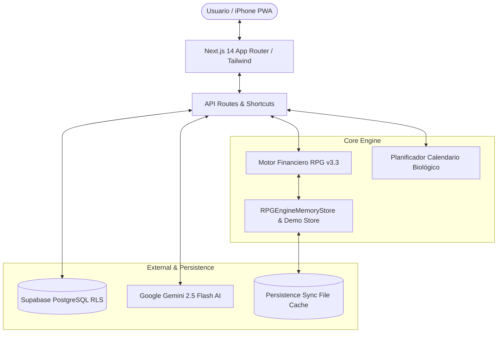

# ⚔️ RPG Life-Engine v3.3: Productividad & Finanzas Personales Gamificadas

> **Convierte tu vida real en un juego de rol de alta disciplina.** Gestiona tus finanzas bajo una economía cerrada libre de culpa, derrota a tus jefes de deuda con matemáticas de Avalancha o Bola de Nieve, planifica tus semanas según tu reloj biológico y domina tus habilidades favoritas con cronómetros en vivo, estanterías 3D y notas de hardware.

[](https://nodejs.org)
[](https://nextjs.org)
[](https://www.typescriptlang.org)
[](https://tailwindcss.com)
[](https://supabase.com)
[](https://deepmind.google/technologies/gemini)
[](https://github.com/isacarlope13/rpg-life-engine)
[](https://railway.app)

---

## 🌟 ¿Qué es RPG Life-Engine?

La mayoría de aplicaciones de finanzas y hábitos fallan porque generan **culpa** o son **tediosas de mantener**. RPG Life-Engine aborda estos problemas mediante principios de psicología del comportamiento y diseño de juegos:

1. **Economía Cerrada Sin Culpa:** Tus gustos no se pagan con dinero que te falta; se financian con **Oro GP** que desbloqueas de tu **Bóveda** a tu **Billetera** cada vez que lees, estudias, entrenas, avanzas en tu trabajo o practicas con tus cubos de Rubik.
2. **Jefes de Deuda con HP Real:** Tus obligaciones (Creditos, Tarjetas de Crédito,...) son monstruos en un calabozo. Cada pago que realizas inflige daño directo a su vida. Puedes alternar en tiempo real entre estrategias matemáticas de **Avalancha** (mayor tasa de interés) o **Bola de Nieve** (menor saldo primero para victorias psicológicas rápidas).
3. **Calendario Biológico:** Tu semana no se planifica con plantillas rígidas irreales, sino a partir de tu **hora real de levantarte y hora de acostarte**, ajustando automáticamente tus bloques de trabajo, transporte, descanso y sesiones de habilidades.
4. **Salas de Habilidades con Páginas Dedicadas:** Cada disciplina cuenta con su propio portal y herramientas especializadas:
   - 🧊 **Cubos de Rubik:** Cronómetro WCA en vivo, scrambles oficiales, historial de solves, penalizaciones (+2/DNF), **Modo Estudio de Nuevos Cubos** y **Cuaderno de Notas de Setup y Mantenimiento**.
   - 📖 **Lectura:** Estantería visual 3D interactiva, extracción de fichas técnicas con IA, calculadora de ritmo diario y captura ultrarrápida de frases y citas por voz.
   - 🧶 **Tejido & Crochet:** Seguimiento de proyectos, contador de filas/vueltas tejidas, registro de hilados y bono de completitud.
   - 🎓 **Estudio:** Modalidades Pomodoro 25/5 y Deep Study 50/10 para enfoque profundo.
   - 💼 **Trabajo (Deep Work):** Bloques de entrega con multiplicadores de impacto (Estándar, Alto Impacto, Hito).
   - 🎮 **Gaming Consciente:** Modo Anti-Tilt con límite de tiempo para evitar rachas de frustración en clasificatorias.
   - 🏅 **Deportes:** Registro de marcas, PRs y niveles de intensidad (Hipertrofia, Recuperación, HIIT).
5. **Cronómetros en Vivo Universales:** Olvídate de calcular o escribir manualmente cuántos minutos hiciste. Presiona **▶ Iniciar Sesión**, enfócate en tu actividad, y al terminar presiona **⏹ Finalizar y Registrar** para reclamar tu XP y GP en un solo clic.
6. **Integración Total con iPhone:** Web App progresiva instalable (PWA), atajos de Siri por voz, automatización por SMS bancarios (Bancolombia, Nu, Davivienda) y escáner de facturas con visión por computadora.

---

## 🏛️ Arquitectura del Sistema



### Tecnologías Principales:
- **Framework:** [Next.js 14](https://nextjs.org) (App Router, Server Actions, API Routes).
- **Lenguaje:** [TypeScript 5](https://www.typescriptlang.org) en modo estricto.
- **Estilos:** [Tailwind CSS 3.4](https://tailwindcss.com) con diseño responsivo mobile-first estilo cyberpunk / RPG oscuro.
- **Iconografía:** [Lucide React](https://lucide.dev).
- **Base de Datos:** [Supabase](https://supabase.com) (PostgreSQL con Row Level Security y triggers automáticos de tesorería).
- **Inteligencia Artificial:** [Google Gemini 2.5 Flash](https://deepmind.google/technologies/gemini) para extracción de fichas técnicas de libros, cubos de Rubik, categorización de SMS bancarios y OCR de recibos.
- **Despliegue Continuo:** [Railway](https://railway.app) conectado al branch `main` de GitHub.

---

## 💰 Economía del Juego & Mecánicas RPG

### 1. El Trío de Tesorería: Bóveda, Billetera y Escudo Aegis
- **Bóveda GP (Gustos Personales):** Se alimenta de un porcentaje mensual de tus ingresos libres. Tiene un tope de seguridad (*Vault Cap*) para evitar acumulación excesiva. Los fondos de la Bóveda están **bloqueados** hasta que realizas actividades de productividad o aprendizaje.
- **Billetera GP:** Es tu oro disponible para gastar en recompensas, salidas, compras o caprichos. Cada minuto de lectura, estudio, trabajo o práctica de Rubik transfiere GP de tu Bóveda a tu Billetera.
- **Escudo Aegis:** Cuando realizas un gasto discrecional y tienes saldo suficiente en tu Billetera GP, el sistema activa automáticamente el Escudo Aegis. Esto previene cualquier penalización a tu racha (*streak*) y te permite disfrutar sin remordimientos.

### 2. Arena de Jefes de Deuda (Debt Bosses Arena)
Tus deudas no son simples números en una tabla; son jefes con puntos de vida (HP):
- **ADDI Boss:** Tasa agresiva (~29.8% E.A.).
- **Nequi Salvavidas:** Tasa moderada.
- **Tarjetas de Crédito:** Jefes adicionales configurables.

#### Estrategias de Combate:
- **🗡️ Avalancha Matemática:** Ataca prioritariamente al jefe con la tasa de interés efectiva anual más alta. Minimiza el costo total de intereses a largo plazo.
- **❄️ Bola de Nieve Psicológica:** Ataca prioritariamente al jefe con el menor saldo de vida restante. Permite eliminar jefes rápidamente y liberar flujo de caja mensual con victorias tempranas.
- **⚡ Limit Break:** Si tienes excedente de oro acumulado, puedes sacrificar GP de tu Bóveda y Billetera para infligir daño directo y masivo a todos los jefes al mismo tiempo, ganando una gran bonificación de XP.

---

## 📅 Calendario Biológico (Wake-Up to Sleep)

A diferencia de los calendarios tradicionales que asumen semanas ideales de 9:00 AM a 5:00 PM, el **Planificador Biológico** se adapta a tus horarios reales:
- Configura tu **hora de levantarte** (ej. `06:00 AM`) y tu **hora de acostarte** (ej. `22:30 PM`).
- Diferencia entre tu rutina de días laborales y tus fines de semana.
- Integra automáticamente tus tiempos de desplazamiento (*commute*), comidas y horas laborales.
- Distribuye tus objetivos semanales de habilidades (minutos requeridos de lectura, tejido, Rubik, estudio) en los bloques libres óptimos según tu preferencia (antes del trabajo, después del trabajo o mixto).

---

## 🧊 Sala Especializada: Cubos de Rubik & Speedcubing

El apartado de Cubos de Rubik incluye tres modos de operación integrados:

### 1. ⚡ Modo 1: Práctica WCA (Speedcubing)
- **Scramble Oficial:** Generador de mezclas oficiales de la World Cube Association (3x3, 2x2, 4x4, Pyraminx, Megaminx).
- **Cronómetro de Solve:** Conteo en milisegundos con inicio/parada por botón o teclado.
- **Métricas WCA Oficiales:** Cálculo automático de Single PB, Ao5 (Average of 5) y Ao12 con descarte de mejores y peores tiempos según la regla WCA 9f9.
- **Penalizaciones Oficiales:** Soporte para tiempo limpio (`OK`), penalización de `+2` segundos y `DNF` (Did Not Finish).

### 2. 🎓 Modo 2: Estudio & Nuevo Cubo
- **Cronómetro de Estudio en Vivo:** Para aprender algoritmos y reconocimiento de patrones con calma, sin la presión de un solve cronometrado.
- **Enfoques de Estudio:** F2L & Lookahead fluido, algoritmos OLL/PLL, paridades de cubos grandes (4x4 OLL/PLL parity), fingertricks y memorización para 3x3 a ciegas (BLD).
- **Recompensas de Estudio:** Otorga +120 XP y +3.500 GP por bloque de aprendizaje.

### 3. 📓 Cuaderno de Notas & Mantenimiento del Cubo (Arsenal Hardware)
Cada cubo de tu colección tiene necesidades de ajuste y mantenimiento únicas. El cuaderno te permite registrar y persistir:
- **Tensiones y Compresión:** Ajuste dual de compresión, distancia entre ejes y fuerza magnética.
- **Lubricación:** Tipos de lubricante utilizados en pistas y núcleo (ej. Lubest Pro, Weight 5).
- **Necesidades y Pendientes:** Alertas de limpieza profunda, repuestos de imanes, cambio de stickers o compra de accesorios.
- **Algoritmos por Dominar:** Casos específicos que te cuesta ejecutar con ese cubo en particular.
- **Bitácora de Giro:** Sensaciones de elasticidad, corte de esquinas y estabilidad.
- *Las notas se sincronizan automáticamente con `localStorage` y la base de datos de tu perfil.*

---

## 📱 Guía de Uso en iPhone

Consulta la documentación completa en [docs/GUIA_IPHONE.md](docs/GUIA_IPHONE.md) para instrucciones detalladas paso a paso sobre:
1. **Instalación de la PWA:** En Safari iOS mediante *"Compartir -> Agregar a pantalla de inicio"*.
2. **Modo Rápido Móvil (`/quick`):** Vista minimalista de 5 segundos para compras en la calle.
3. **Automatización por SMS Bancario:** Captura automática de compras de Bancolombia, Nu, Davivienda y RappiCard mediante Apple Shortcuts.
4. **Comandos de Voz con Siri:** *"Oye Siri, Registrar Lectura"* o *"Oye Siri, Registrar Solve"*.
5. **Escáner de Facturas:** Envío de fotos de recibos a Gemini Vision para desglose de rubros.
6. **Widget de Scriptable:** Barra de estado RPG en tu pantalla de bloqueo y pantalla de inicio.

---

## 🚀 Despliegue & Variables de Entorno

El proyecto está configurado para desplegarse automáticamente en [Railway](https://railway.app).

### Variables de Entorno Necesarias:

| Variable | Descripción | Obligatorio |
| :--- | :--- | :--- |
| `NEXT_PUBLIC_SUPABASE_URL` | URL de tu proyecto Supabase | Sí (en prod) |
| `NEXT_PUBLIC_SUPABASE_ANON_KEY` | Clave anónima pública de Supabase | Sí (en prod) |
| `SUPABASE_SERVICE_ROLE_KEY` | Clave de servicio para sincronización segura | Sí (en prod) |
| `GEMINI_API_KEY` | Clave de Google AI Studio para Gemini 2.5 Flash | Recomendado |
| `SHORTCUT_API_KEY` | Token secreto para autenticar Atajos de iPhone | Opcional |
| `PORT` | Puerto HTTP (Railway lo inyecta automáticamente) | Automático |

### Despliegue en Railway:
1. Conecta tu repositorio de GitHub a Railway.
2. Railway detectará automáticamente el archivo `.node-version` (Node 22) y ejecutará:
   ```bash
   npm install
   npm run build
   npm start
   ```
3. Agrega las variables de entorno en la pestaña **Variables** de Railway.
4. La aplicación quedará disponible en tu dominio `*.up.railway.app`.

---

## 🧪 Pruebas Automatizadas

El proyecto cuenta con una suite completa de pruebas unitarias y de integración que verifican la consistencia matemática, el cumplimiento del reglamento WCA y la idempotencia de los endpoints:

```bash
# Ejecutar la suite de pruebas
npm test

# Verificar tipos de TypeScript
npx tsc --noEmit
```

### Casos de Prueba Verificados (10/10 passing):
1. Algoritmo WCA de mezclas y medias recortadas (Ao5 / Ao12 con descarte de extremos).
2. Santuario de Habilidades: PBs de Rubik, completitud de libros, tejido y trabajo.
3. Protección contra llamadas duplicadas (Idempotencia en APIs y Shortcuts).
4. Desbordamiento de daño combo entre jefes y contraataque por sobrecostos.
5. Comparador de estrategias de deuda (Avalancha vs Bola de Nieve) y GameMaster.
6. Regla WCA 9f9: Manejo de DNF único vs doble DNF en Ao5/Ao12 y penalizaciones +2s.
7. Prevención de doble conteo de páginas de lectura y filas de tejido.
8. Parseo robusto de divisas y formatos de SMS bancarios colombianos.
9. Integración con Supabase y verificación de esquemas SQL.
10. Extractores de especificaciones con IA (hardware de cubos y fichas de libros).

---

## 📄 Licencia

Este proyecto está bajo la licencia MIT. Creado para dominar la vida real, superar las deudas y alcanzar la maestría en cada disciplina elegida.
