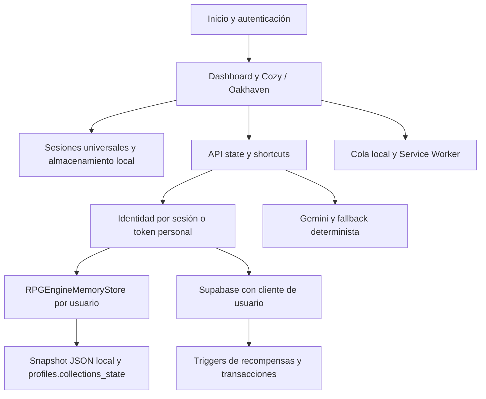

# Ingeniería inversa y propuesta de mejoras

Fecha: 11 de noviembre de 2026. Análisis del árbol de trabajo actual, incluidos cambios locales preexistentes. No se modificó código funcional.

## Resultado

El proyecto ya contiene un dominio amplio y motores deterministas con pruebas. La prioridad es asegurar que un registro confirmado sobreviva a desconexiones, reinicios y concurrencia. Ampliar edificios o automatizaciones antes de resolver estos puntos aumentaría el costo de mantenimiento.

## Arquitectura reconstruida

La entrada `/` presenta la landing. `/dashboard` monta `RPGLifeEngineDashboard` y `/cozy` monta `CozyRpgDashboard`. La consulta `/api/state` autentica, intenta construir el estado desde Supabase y puede devolver una alternativa local. Los endpoints de gastos y hábitos tienen ramas distintas para Supabase y memoria. Las sesiones y colecciones incorporan además snapshots JSON. Por ello, hay varios lugares capaces de representar o modificar un mismo concepto.

Fortalezas verificadas: identidad derivada del servidor, claves de idempotencia acotadas al usuario en `request-auth.ts`, políticas RLS en el esquema, bloqueos `FOR UPDATE` en triggers financieros y motor de sesiones basado en marcas de tiempo. Estas protecciones son una base útil para las mejoras.

## Hallazgos y propuestas priorizadas

### P0 — La sincronización offline puede descartar operaciones sin guardar

Evidencia: `public/sw.js`, rama `/api/`, devuelve HTTP 200 con `{ offline: true }` al fallar la red. `src/lib/offline-sync.ts`, `processOfflineQueue`, elimina una operación cuando `res.ok` es verdadero sin comprobar confirmación del servidor.

Consecuencia deducida: si falla la conexión durante un reintento con el Service Worker activo, la cola puede considerar sincronizada una operación que nunca llegó al servidor.

Propuesta: devolver 503 en el fallback de API y exigir una confirmación de dominio con identificador de operación antes de retirar el elemento. Mantener una clave de idempotencia estable durante todos los reintentos.

Criterio de aceptación: cortar la red durante el envío conserva la operación pendiente; restaurarla produce exactamente un registro y una recompensa.

### P0 — La cola offline no identifica al propietario

Evidencia: `OfflineAction` no incluye usuario y la clave `rpg_offline_queue_v1` es global para el navegador. El reenvío utiliza la sesión vigente.

Consecuencia deducida: una acción pendiente de A puede enviarse con la sesión de B tras cambiar de cuenta en el mismo navegador. Además, dos procesadores simultáneos pueden leer la misma cola; la escritura final de `remaining` puede sobrescribir elementos añadidos durante el procesamiento.

Propuesta: cola por usuario con IndexedDB, identificador estable por operación, exclusión entre procesadores y eliminación individual de registros confirmados. Bloquear la reproducción si cambia la identidad.

Criterio de aceptación: A registra offline, cierra sesión y entra B; B nunca envía ni consulta las acciones de A. Dos pestañas y una nueva acción durante la sincronización no pierden ni duplican registros.

### P1 — La restauración no reconstruye fielmente el snapshot

Evidencia: `src/lib/persistence-sync.ts`, `applyPersistedCollectionsToStore`, exige `length > 0` para varias colecciones. `bosses` se serializa pero no se aplica en esa función. La hidratación local restaura solo algunos de los campos financieros serializados.

Consecuencia: un snapshot vacío no vacía el estado existente; deudas y parámetros pueden conservar valores iniciales o anteriores. El problema afecta especialmente la recuperación local; Supabase reconstruye parte del estado por otras consultas.

Propuesta: contrato versionado de snapshot, validación al leer, restauración explícita de todos los campos y distinción entre ausente y vacío. Para disco, escritura temporal y reemplazo atómico.

Criterio de aceptación: serializar, reiniciar y restaurar produce el mismo estado relevante, incluidos colecciones vacías, deudas y configuración financiera.

### P1 — Confirmación de persistencia insuficiente

Evidencia: `persistUserCollectionsState` oculta fallos de disco y no inspecciona el resultado `{ error }` del `update` de Supabase. El cliente puede informar ese error sin lanzar una excepción.

Propuesta: devolver un resultado explícito de persistencia, registrar fallos y diferenciar pendiente de guardado de confirmado. Incorporar revisión de snapshot para detectar actualizaciones concurrentes en vez de sobrescribir silenciosamente.

Criterio de aceptación: un error simulado de base de datos no termina en una confirmación de guardado; dos escrituras con la misma revisión detectan el conflicto.

### P1 — Las reglas y escrituras tienen varias autoridades

Evidencia: `demo-store.ts` calcula recompensas y gastos; `supabase/schema.sql` contiene triggers para esos mismos dominios. `quick-expense` y `habit-log` eligen implementaciones según el modo; `skill-session` también opera con el store y snapshots.

Riesgo de diseño: diferencias entre modo local y Supabase, y saldos o colecciones que divergen entre tablas normalizadas, memoria y JSONB. No se verificó aquí una discrepancia matemática específica entre ambos motores.

Propuesta: separar reglas puras, comandos de aplicación y repositorios. Definir Supabase como autoridad de producción; memoria como adaptador de demostración. Registrar evento, efecto económico e idempotencia en una misma transacción. Mantener snapshots como proyecciones recuperables.

Criterio de aceptación: una batería contractual ejecuta las mismas entradas contra ambos adaptadores y compara resultados; reinicios y solicitudes simultáneas conservan las invariantes.

### P1 — Reintentos y validación de APIs incompletos

Evidencia: `quick-expense` y `habit-log` convierten un error de inserción, incluida una colisión de clave única, en HTTP 500. Leer el cuerpo mediante `as Tipo` no valida el JSON en ejecución. La validación de monto de `quick-expense` comprueba positividad, pero no tipo numérico finito ni límites.

Propuesta: validadores de entrada compartidos, categorías cerradas y límites de negocio. Ante una clave ya utilizada, recuperar la respuesta original y verificar que el contenido coincide; devolver conflicto si cambia el contenido.

Criterio de aceptación: JSON inválido obtiene 400; repetir una operación retorna el mismo identificador sin efectos nuevos; reutilizar su clave con otro monto se rechaza.

### P2 — El límite de IA se comparte entre usuarios

Evidencia: `gemini.ts` llama `checkAiQuotaAllowance` con constantes como `expense_sms` y `book_extractor`. El limitador guarda contadores en un `Map` del proceso.

Consecuencia: son cuotas por función y proceso, aunque los comentarios las describen por usuario. Un usuario puede consumir el cupo de otros; varias instancias tienen contadores independientes.

Propuesta: propagar identidad autenticada a los servicios de IA y almacenar contadores atómicos compartidos por usuario y ventana. Mantener un presupuesto global adicional. Versionar y expirar las fichas de caché cuando corresponda.

Criterio de aceptación: agotar la cuota de A no bloquea a B; dos instancias respetan el mismo límite.

### P2 — La cola de automatización no garantiza exclusión ni durabilidad

Evidencia: `automation/task-queue.ts` mantiene tareas e índice en memoria, indexa solo por clave y permite entrar a `processTask` cuando el estado es `processing`. `backoffMs` se almacena, pero esa función no comprueba una fecha de próximo intento.

Propuesta: clave compuesta por usuario y operación; reclamación atómica de tarea, lease, `next_attempt_at` y almacenamiento durable si se utiliza en producción.

Criterio de aceptación: dos workers concurrentes ejecutan una sola vez; reiniciar recupera pendientes; el reintento respeta la fecha programada.

### P2 — El tamaño de los componentes dificulta cambios seguros

Evidencia: `rpg-dashboard.tsx` ocupa aproximadamente 397 KB y `demo-store.ts` 116 KB en el árbol inspeccionado. Existen dos dashboards y módulos extensos de edificios.

Propuesta: extraer por dominio —finanzas, sesiones, biblioteca, proyectos— y compartir hooks y servicios entre interfaces. Cargar interiores bajo demanda. Medir tamaño de bundle y rendimiento antes y después; el tamaño de fuente no demuestra por sí solo lentitud en el navegador.

Criterio de aceptación: cada dominio cambia sin editar el contenedor principal; abrir un edificio carga su módulo cuando se necesita y mantiene la sesión universal.

### P2 — La cobertura actual no equivale a recorridos completos de usuario

Evidencia: hay buenas pruebas de motores, pero algunos checks leen archivos y verifican cadenas. Los recorridos Oakhaven inspeccionados ejercitan funciones y almacenamiento, sin conducir un navegador real. README describe versiones de dependencias y un total de pruebas que ya no corresponden a package.json ni a la ejecución actual.

Propuesta: conservar pruebas deterministas y añadir integración HTTP con Supabase de pruebas, más recorridos de navegador para cambio de cuenta, red intermitente, recarga y recuperación de sesión. Actualizar README y validar el comando de lint definido como `next lint` en el entorno real.

Criterio de aceptación: CI detecta el fallo offline descrito en este informe y verifica aislamiento entre usuarios. La documentación refleja dependencias, rutas y comprobaciones vigentes.

## Mejoras de producto

1. Mostrar estados verificables de cada registro: pendiente, sincronizando, confirmado y requiere atención. El usuario debe poder revisar y reintentar pendientes.
2. Ofrecer una vista diaria breve: siguiente actividad, sesión activa y dinero disponible, con acceso al pueblo y a los detalles existentes.
3. Explicar cada movimiento económico: actividad o gasto de origen, GP transferidos, saldo anterior y posterior y motivo de cualquier penalización.
4. Medir la utilidad antes de ampliar la gamificación: finalización de onboarding, primera sesión confirmada, errores de sincronización, tiempo para registrar un gasto y retorno semanal.

## Secuencia recomendada

1. Integridad inmediata: corregir falso éxito offline, aislar cola por usuario y hacer fiel la restauración. Añadir regresiones de estos escenarios.
2. Consistencia: confirmación durable, validación de entradas, replay idempotente y pruebas contractuales entre adaptadores.
3. Operación: cuotas reales de IA, automatizaciones durables y observabilidad de errores de persistencia y sincronización.
4. Mantenimiento y experiencia: dividir componentes, medir carga, añadir recorridos de navegador y actualizar documentación.

## Verificación y límites

- `npm test`: 174 pruebas aprobadas, 0 fallidas.
- `npx tsc --noEmit`: terminó correctamente, sin errores.
- Las pruebas generan advertencias de detección de módulos en Node; revisar la configuración de módulos antes de cambiar `type` en package.json.
- No se ejecutaron pruebas de navegador, despliegue, migraciones ni operaciones contra una base de datos de producción. Los riesgos de ejecución descritos se deducen de las rutas de código; no se presentan como incidentes observados.
- Se respetaron los cambios locales preexistentes en `src/components/rpg-dashboard.tsx` y `tests/oakhaven-45-user-journeys.test.ts`.
