# OAKHAVEN AI ARCHITECTURE — FASE 1

## 1. Visión General
OakHaven AI evoluciona los asistentes existentes hacia un sistema conectado a los **datos reales del usuario autenticado**, estructurado en dos capas:
1. **Presidente Rowan (`oakhaven.mayor.rowan`)**: Orquestador central de solo lectura (Nivel 1) integrado en el Ayuntamiento (`MayorsLedgerModal` + `POST /api/ai/mayor/chat`).
2. **8 Especialistas por Edificio**: Registro de capacidades en runtime (`src/lib/ai/building-skills-registry.ts`), uno por cada edificio definitivo del pueblo personal.

## 2. Separación estricta: Skills de Desarrollo vs Skills en Runtime
- **`.agents/skills/*/SKILL.md`**: Guías de desarrollo utilizadas por agentes de programación en tiempo de desarrollo. **No se ejecutan en producción ni se conectan automáticamente a Gemini ni a Supabase.**
- **`src/lib/ai/building-skills-registry.ts`**: Registro tipado en TypeScript que sí se ejecuta dentro de Next.js/API Routes, con listas blancas de herramientas, contrato de recursos, niveles de autonomía y configuración de modelo.

## 3. Flujo de una Consulta al Presidente Rowan

```mermaid
flowchart LR
    U[Jugador en Ayuntamiento] --> UI[mayors-ledger-modal.tsx]
    UI --> API["POST /api/ai/mayor/chat"]
    API --> AUTH["requireShortcutUser (Server Auth + RLS)"]
    AUTH --> QUOTA["checkAiQuotaAllowance (Rate Limit)"]
    QUOTA --> GUARD["detectUnsafeActionRequest (Nivel 3 Block)"]
    GUARD --> PLAN["selectToolsForQuestion (máx 3 tools)"]
    PLAN --> TOOLS["executeMayorReadOnlyTool (Solo Lectura)"]
    TOOLS --> DB[("Supabase RLS / Store / Local Snapshot")]
    DB --> DRAFT["buildDeterministicGroundedAnswer (Cero Alucinaciones)"]
    DRAFT --> LLM["Gemini 2.5 Flash (Opcional, timeout 7s, fallback determinista)"]
    LLM --> UI
```

## 4. Fuentes de Datos (Remotas vs Locales)
- **Remotas (Supabase con RLS `auth.uid() = user_id`)**: `reading_books`, `knitting_projects`, `financial_transactions`, `activity_logs`, `rubik_solves`, `player_treasury`.
- **Estado de sesión / servidor (`store`)**: `workProjects`, `spacedCards`, fallback sin Supabase.
- **Solo navegador local (`localStorage`)**:
  - **Cine (`cinema-store.ts`)**: `oakhaven_cinema_catalog_v1_<ownerId>`.
  - **Patrones e imágenes de Crochet (`atelier-patterns-store.ts`)**: `oakhaven_atelier_patterns_v1_<ownerId>`.
  - Cuando consultas a Rowan desde el navegador actual, el cliente envía un `local_snapshot` de solo lectura; si consultas desde otro dispositivo sin sincronización en nube, Rowan informa explícitamente la limitación.
- **Migración aditiva preparada (no aplicada)**: `supabase/drafts/20261119_oakhaven_ai_phase1_sync.sql`.
