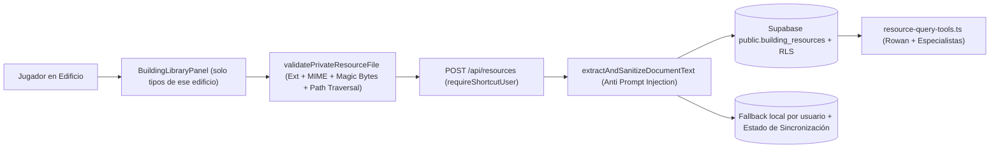

# PHASE 2 RESOURCE ARCHITECTURE — BIBLIOTECAS PRIVADAS POR EDIFICIO

## 1. Para qué sirve y cómo la usarás
Cada uno de los **8 edificios definitivos** de OakHaven cuenta ahora con su propia **Biblioteca Privada temática** accesible desde el interior del edificio (`BuildingLibraryPanel` dentro de `LivingInteriorRoom`), mostrando **únicamente** los tipos de archivos que tienen sentido en esa actividad.

## 2. Archivos que intervienen
- **Motor central y validación real:** `src/lib/ai/building-resources-engine.ts` (`BUILDING_LIBRARY_CONFIG`, `validatePrivateResourceFile`, `sniffFileMagicBytes`, `extractAndSanitizeDocumentText`).
- **API autenticada:** `src/app/api/resources/route.ts` (`GET`, `POST`, `DELETE` con archivado lógico `deleted_at`).
- **Interfaz reutilizable:** `src/components/sanctuary/building-library-panel.tsx` montada en `src/components/sanctuary/living-interior-room.tsx`.
- **Herramientas de consulta para IA:** `src/lib/ai/resource-query-tools.ts`.
- **Migración aditiva preparada (no ejecutada):** `supabase/drafts/20261119_phase2_private_storage_and_resources.sql`.

## 3. Qué se guarda en Supabase vs qué queda local
- **En Supabase (al aplicar migraciones):** metadatos completos en `public.building_resources` (con RLS `auth.uid() = user_id`), texto extraído seguro (nunca de archivos financieros) y archivos binarios en el bucket privado `oakhaven-private-resources`.
- **Local mientras no se aplique la migración:** copia ligera de metadatos por usuario en `localStorage` con badge explícito `Guardado localmente` o `Pendiente de sincronización` (nunca se afirma "Sincronizado en nube" si solo está en el navegador).
- **Invariante económica:** subir, consultar o archivar recursos **jamás** modifica GP, XP ni saldos COP.
