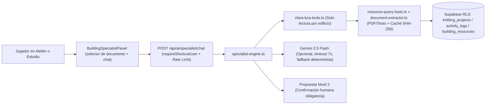

# PHASE 3 SPECIALIST SKILLS — CLARA (CROCHET) Y LYRA (ESTUDIO)

## 1. Arquitectura de Skills Activas (Fase 3)
En Fase 3 se activaron las dos primeras Skills documentales completas (**Clara** en `atelier` y **Lyra** en `biblioteca`), reutilizando **sin duplicación** la interfaz `building-specialist-panel.tsx`, el endpoint `POST /api/ai/specialist/chat`, el extractor documental `src/lib/ai/document-extractor.ts` y la tabla `public.building_resources` en Supabase.

## 2. Separación estricta de fuentes
- **`[Tus registros]` / `[Contenido de tu documento]`**: texto real extraído con citas de página (`[Página N]`) o datos de tus tablas.
- **`[Conocimiento general]`**: glosario de abreviaturas de crochet o explicaciones conceptuales.
- **`[Sugerencia orientativa]` / `Propuesta Nivel 2`**: recomendaciones y acciones que **nunca se guardan sin pulsar `✓ Confirmar`**.
- **Nivel 3 bloqueado:** Clara y Lyra jamás alteran COP, GP, XP ni ejecutan pagos.

## 3. Extracción Documental y Control de Costos (`src/lib/ai/document-extractor.ts`)
- Soporta `.txt`, `.md`, `.csv`, `.json` y **PDFs con capa de texto** (incluyendo streams comprimidos `FlateDecode` vía `node:zlib` sin dependencias pesadas).
- **Detección honesta de limitaciones:** si un PDF está escaneado (sin texto extraíble) o si subes una imagen (sin OCR automático en Fase 3), la Skill informa la limitación y **no inventa contenido**.
- **Caché por `content_hash`:** evita reprocesar archivos idénticos.
- **Anti Prompt Injection:** todo texto extraído se trata como dato no confiable antes de pasarse a Gemini.
