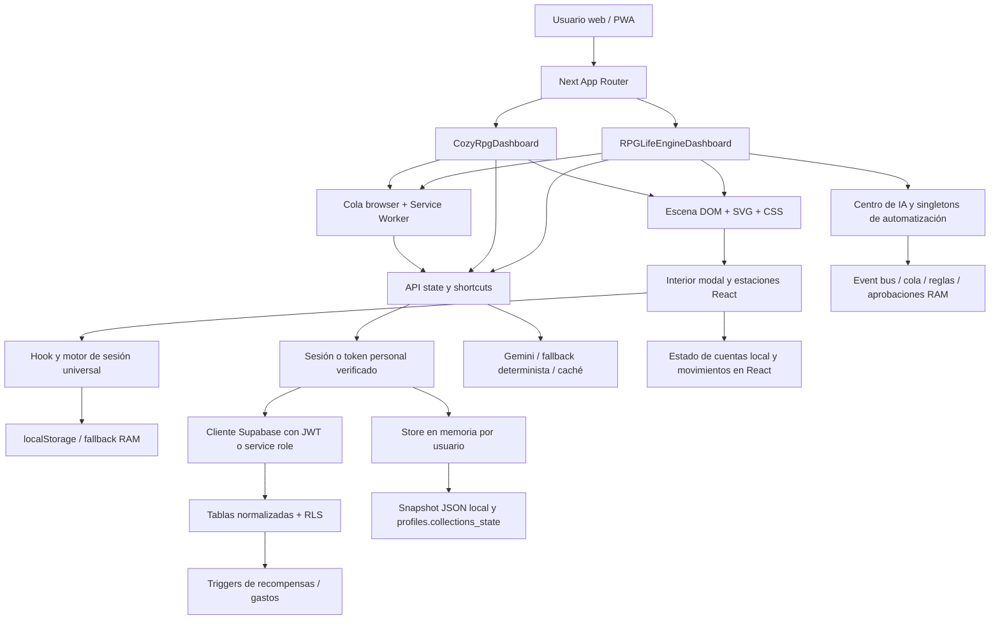

# Mapa de arquitectura e inventario

Fecha: 11 de noviembre de 2026. Inventario por árbol de trabajo, imports, puntos de entrada y lockfile; no describe infraestructura desplegada verificada.

Al cierre apareció una prueba adicional y cambios concurrentes en offline, snapshots y APIs. El total de 174 tests y cifras de build son baseline inicial; el árbol final tiene 17 archivos de pruebas. Consulte la conciliación de [OAKHAVEN_AUDIT.md](OAKHAVEN_AUDIT.md).

## Stack real

| Pieza | Rango declarado | Resuelto en package-lock.json |
|---|---|---|
| Node | 22.x | Requisito; no versión de producción comprobada |
| Next.js | ^15.2.0 | 15.5.29 |
| React / React DOM | ^19.0.0 | 19.3.1 |
| TypeScript | ^5.7.3 | 5.9.3 |
| Tailwind | ^4.0.0 | 4.3.4 |
| Supabase JS | ^2.49.1 | 2.119.0 |
| Google GenAI | ^1.0.0 | 1.52.0 |

Otras dependencias directas: Chart.js ^4.6.1, react-chartjs-2 ^5.3.1, clsx ^2.1.1, lucide-react ^0.475.0 y tailwind-merge ^3.0.2. Desarrollo: PostCSS de Tailwind y tipos Node/React. No hay PixiJS ni Phaser declarados. README no refleja el stack efectivo; la fuente de versiones para esta tabla es `package.json` y `package-lock.json`, no badges.

## Estructura

| Carpeta | Responsabilidad observada |
|---|---|
| `src/app` | App Router, páginas, layouts, errores globales, manifiesto y endpoints |
| `src/components` | Landing, dashboards clásico/Cozy, IA, finanzas, audio |
| `src/components/cozy` | Header, sidebar, tarjetas, ventanas, diálogos, edificios pixel art |
| `src/components/sanctuary` | Mapa, escena con cámara, interiores por habilidad, Banco, estaciones |
| `src/lib` | Auth, Supabase, ensamblado de estado, motor en memoria, Gemini, calendario, snapshots, offline y exportación |
| `src/lib/sanctuary` | Sesión universal, progresión, preferencias, finanzas/Banco/deuda, residentes y recursos |
| `src/lib/agents` | Coordinador, guardián, captura, planificador, misiones, análisis de gastos y habilidades |
| `src/lib/automation` | Event bus, cola, invariantes, aprobaciones, auditoría y scheduler |
| `src/lib/integrations` | Formateadores Calendar/Notion, salida webhook |
| `src/types/rpg.ts` | Contratos amplios de negocio y UI |
| `supabase` | Esquema, seed, onboarding y dos migraciones fechadas |
| `tests` | 16 archivos en ejecución inicial de 174 pruebas; 17 al cierre por cambio concurrente |
| `public` | Assets y Service Worker; no es un motor de juego independiente |
| `docs/cozy-village` | Planes, arquitectura e informes anteriores, contrastados con código |

Se inventariaron 146 archivos TS/TSX en `src`. No se leyeron dependencias instaladas completas ni assets binarios innecesariamente.

## Mapa actual

Lectura importante: el Banco no es simplemente una vista del libro durable de Supabase; tiene un flujo local propio. El coordinador de agentes tampoco equivale a un worker durable en producción. Los errores de esas separaciones se documentan como D-002, A-001 y S-004.

## Rutas de página

| Ruta | Entrada / función |
|---|---|
| `/` | `src/app/page.tsx`, landing |
| `/login` | Acceso |
| `/onboarding` | Configuración y asistencia inicial |
| `/dashboard` | Dashboard principal |
| `/cozy` | Dashboard Cozy alternativo |
| `/cozy/design-system` | Muestra de componentes |
| `/quick` | Captura rápida |
| `/skills/[domain]` | Sala por dominio; comparte carga del dashboard |
| `/privacidad` | Política |
| `/manifest.webmanifest` | Generado por `src/app/manifest.ts`; también existe referencia a `/manifest.json` en layout/SW |

Los manifiestos deben contrastarse por contenido/headers antes de consolidarlos; tener dos rutas no demuestra por sí solo un fallo PWA.

## APIs encontradas

| Grupo | Endpoints | Dependencias relevantes |
|---|---|---|
| Auth | `/api/auth/login`, `/logout`, `/demo` | Supabase Auth, cookies HttpOnly o registro local; demo bloqueada en producción |
| Estado | `/api/state` | Auth → state-builder → tablas + colecciones + fallback |
| Onboarding | `/api/onboarding`, `/api/onboarding/ai` | Perfil, nombre, finanzas, profesiones, misiones; AI autenticada con clave de cuota por usuario |
| Captura | `/api/shortcuts/omni`, `/quick-expense`, `/receipt-scan` | Auth/token, parseo IA o determinista, motor financiero |
| Actividades | `/api/shortcuts/habit-log`, `/skill-session` | Store, tablas, GP/XP, colecciones y múltiples acciones |
| Deuda/widgets | `/api/shortcuts/boss-counterattack`, `/widget-summary` | Identidad y estado RPG |
| Narrativa | `/api/gamemaster/briefing` | Gemini/fallback y métricas |
| Operación | `/api/health` | Configuración, versión y estadísticas de proceso |
| Audio | `/api/spotify/now-playing` | Credenciales globales Spotify; excepción de auth, S-003 |

`skill-session` agrupa registro de colecciones, notas, proyectos, estrategias, Limit Break y sesiones. Separar comandos internos permitiría conservar esta API para Shortcuts sin mantener toda la lógica en un único handler.

## Datos y persistencia

| Dato | Ubicación observada | Garantía / límite |
|---|---|---|
| Identidad real | Supabase Auth, perfiles y tokens hash | JWT verificado; requiere comprobar RLS desplegada |
| Identidad local | Maps de `auth.ts` | Volátil; no confundir con usuarios durables de producción |
| Tesorería | `player_treasury` + copia store + snapshot | Varias representaciones; transacciones parciales fuera de triggers |
| Deudas | `debt_bosses` + store + caso del Banco | No todas las vistas tienen el mismo proveedor |
| Actividades / gastos | `activity_logs`, `financial_transactions` | Índices de idempotencia y triggers en esquema base |
| Libros, cubos, tejido, wishlist | Tablas y `profiles.collections_state` | Superposición de persistencia; D-004/D-005 |
| Sesión activa | localStorage v4, compatibilidad v3 y hook | Hidratación validada por usuario en motor, pero historial y defaults requieren revisar S-001 |
| Movimientos del Banco | Estado React inicializado con fixture | No durabilidad de altas locales, D-002 |
| Cuentas Banco | Clave local global | Persistencia solo en navegador y sin aislamiento de cuenta, S-001 |
| Residentes / progresión | Claves por usuario en motores específicos | Patrón mejor acotado; verificar que llamadores pasen identidad real |
| Cola offline / notas / cámara / posiciones | Claves browser globales en flujos inspeccionados | Diferenciar preferencias de datos sensibles |
| Cola, aprobaciones, logs de agentes | Maps/arrays | No un sistema de jobs ni auditoría inmutable durable |

El esquema base tiene FKs a `auth.users`, relación de actividad con tesorería, índices únicos y checks de saldos/HP, además de RLS. Eso protege parte de la integridad. No se verificó una restricción de negocio completa que impida cualquier recompensa manipulada, ni permisos efectivos desplegados.

Archivos SQL: `supabase/schema.sql`, `seed.sql`, `onboarding_migration.sql`, `migrations/20261107_collections_and_trial.sql` y `migrations/20261109_v3_5_complete_engine_sync.sql`. La migración completa crea tablas/políticas, pero no incluye las definiciones de triggers de recompensa del esquema base; ejecutar solo ese archivo no demuestra equivalencia con el esquema completo. No se ejecutó ninguno. Recomendación operativa: documentar un orden reproducible y probar desde una DB vacía y desde una copia anonimizada existente.

## Motores y agentes

El motor grande `demo-store.ts` combina tesorería, deudas, sesiones, catálogo, proyectos, tarjetas de repetición y talentos. `calendar-planner.ts` planifica horarios; módulos `sanctuary` proyectan progresión, bienestar financiero, deuda, Banco, wishlist, gimnasio y preferencias. `gemini.ts` mezcla extractores, parsers y auxiliares deterministas; `onboarding-ai.ts` coordina alta asistida. El uso de nombres demo no garantiza que sean exclusivos de demo: los handlers los usan para usuarios autenticados.

Clases existentes en `agents`: AutonomousLifeManager, SystemGuardian, LifeCaptureAgent, DailyPlannerAgent, DynamicQuestGenerator, SmartExpenseEngine y SkillEvolutionAgent. El consejo anuncia además roles life_analyst, goal_predictor, economic_intelligence y reward_optimizer; no se encontraron clases/worker registrados de esos roles en `src`. El coordinador los enruta, pero `registerWorker`/`processTask` solo aparecen como definiciones dentro de la cola, sin un bucle de ejecución conectado en `src`. No presentar once roles listados como once servicios autónomos operativos.

Calendar genera payloads y feed `.ics`; Notion construye contenido y payloads. Estos adaptadores no implementan por sí solos OAuth ni sincronización remota. Webhook sí contiene `fetch`; Spotify sí consulta red; Gemini usa el SDK real cuando está configurado. Las pruebas de formateo no certifican una integración externa activa.

## Complejidad, duplicación y obsolescencia

Hay dos sistemas sonoros: `lib/cozy/cozy-soundscape.ts` con presets y `lib/sanctuary/cozy-soundscape.ts` con ambiente procedimental. Hay `buildings-registry.ts` y `village-buildings-registry.ts`, mapa Cozy y escena interactiva, y ramas de selección de edificio repetidas en dashboards. Son responsabilidades solapadas; hace falta mapear consumidores antes de eliminar nada. No se afirma código muerto solo por similitud de nombre.

README y versiones visibles del proyecto están desalineados con package/lockfile y nuevas suites. Los números 3.x/4.x mezclan versión de paquete y hitos del mundo. Consolidar metadatos y estado real reduce informes que aparentan más implementación que la observada.

La búsqueda automatizada de ciclos estáticos no detectó ninguno. No sustituye analizar límites de responsabilidad: el store importa extractores de `gemini.ts`, por lo que reglas puras quedan acopladas al módulo de IA y sus dependencias. Extraer parsers puros es una oportunidad concreta sin reescritura total.

## Despliegue

`next.config.ts`: salida standalone, strict mode y cabeceras defensivas. Docker usa Node 22 Alpine, `npm ci`, build separado y runner no root. Railway configura Nixpacks y `npm run start` con reintentos; Vercel declara framework y región. Su coexistencia no demuestra tres despliegues activos. El JSON en `.data` requiere disco persistente si se pretende conservarlo; no es respaldo durable en una instancia efímera ni almacenamiento compartido entre réplicas. No se verificaron volúmenes, backups ni configuración remota.
