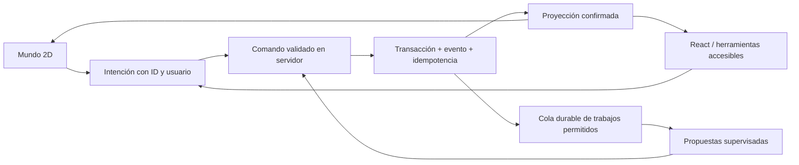

# Roadmap de mejora y aprendizaje

Fecha: 11 de noviembre de 2026. Propuesta de implementación futura; no se ejecuta ningún cambio funcional en esta auditoría. Las estimaciones son días-persona, pueden solaparse y requieren refinamiento. No sumar todas las cifras como calendario prometido.

**Ajuste al cierre:** cambios concurrentes mitigaron D-001 y corrigieron el caso concreto D-004; H1.1/H1.4 deben empezar verificando y completando esos cambios, no rehaciéndolos. H1.3 incorpora R-004, error del replay nuevo. Los demás paquetes siguen pendientes salvo evidencia posterior. Estado detallado en la conciliación de [OAKHAVEN_AUDIT.md](OAKHAVEN_AUDIT.md).

## Criterio de orden

Primero hacer confiable el dato, después convertir una actividad en una experiencia espacial y finalmente ampliar el mundo vivo. Se conserva el motor económico y los registros existentes; cualquier corrección semántica de rachas debe acordarse y probarse antes de migrar históricos. Los detalles de evidencia, causa, impacto y aceptación están en el documento principal o especializado de cada ID.

## Horizonte 1 — Correcciones críticas y base verificable

Objetivo: nunca anunciar un registro confirmado sin guardado durable y no mezclar datos de usuarios.

| Paquete | IDs | Trabajo propuesto | Estimación | Dependencia y riesgo |
|---|---|---|---|---|
| H1.1 Entrega offline | D-001, S-001 | Estado pendiente/confirmado, fallback de error real, propietario e ID estable; procesador único y retirada individual | 3–5 días | Riesgo medio; migración de cola antigua sin apropiarse de acciones ajenas |
| H1.2 Banco durable | D-002, R-003 | Respaldar cuentas locales, separar fixtures, corregir cero/fecha, guardar libro y efectos juntos | 5–10 días | Alto; no reconstruir movimientos inexistentes como si fueran reales |
| H1.3 Comandos económicos | D-003, R-002, S-002 | Transacción única, idempotencia durable, validadores y permisos mínimos | 5–10 días | Alto; inventariar triggers antes de mover escrituras |
| H1.4 Recuperación | D-004, D-005 | Snapshot versionado y validado, errores explícitos, revisión optimista y modo degradado | 3–5 días | Medio; compatibilidad con respaldos previos |
| H1.5 Seguridad inmediata | S-003, S-005, S-006 | Cerrar Spotify, firma sobre mismos bytes, resolver advisories con actualización evaluada | 2–5 días | Medio; no salto mayor automático de framework |
| H1.6 Contrato y calidad | R-001, Q-001 | Formalizar racha por día, regresiones, lint no interactivo, CI y DB de pruebas aislada | 3–7 días | Medio–alto si cambia históricos; ninguna regla se modifica por inferencia |

Puerta de salida: pruebas de replay y concurrencia con DB de pruebas, recuperación tras reinicio, cambio A/B sin mezcla, red intermitente con SW y libro de cuentas consistente. Guardar y exportar respaldos antes de cualquier futura migración; validar lectura antigua, rollback y reconciliación en copia anonimizada. No limpiar `.data` ni storage «para arreglar» la aplicación.

### Pruebas que faltan y deben anteceder a las correcciones

1. SW activo devuelve desconexión durante envío y después de commit: cola no pierde acción ni duplica efecto.
2. Dos pestañas procesan la cola mientras se agrega un elemento nuevo: nada se sobrescribe.
3. Repetir Limit Break con la misma clave, antes y después de reiniciar, y en paralelo: un solo efecto.
4. Guardar movimiento y saldo; desmontar Banco, recargar y entrar desde otro dispositivo: mismo libro.
5. Round-trip de snapshot vacío/completo/antiguo/corrupto y fallo de permisos remoto.
6. Cero en cuenta y cambio de fecha/zona horaria: plan consistente y sin fallbacks ficticios.
7. Dos JWT contra RLS y REST directo: aislamiento y prohibición de escribir efectos no autorizados.
8. Receptor webhook verifica bytes reales y rechaza alteración; firma no sustituida por mock.

## Horizonte 2 — Transformar el ciclo de interacción

Objetivo: un recorrido completo se siente situado en un mundo y conserva productividad, accesibilidad y rapidez.

| Paquete | IDs | Trabajo propuesto | Estimación | Resultado evaluable |
|---|---|---|---|---|
| H2.1 Límites de dominio | A-001 | Extraer comandos y proyecciones de sesiones/Atelier; servicio compartido para ambas interfaces | 4–7 días | La escena no modifica GP directamente |
| H2.2 Accesibilidad de base | U-004 | Diálogo común, foco, retorno, fondo inerte y lista alternativa de edificios | 2–4 días | Recorrido completo con teclado y lector de pantalla de prueba |
| H2.3 Piloto espacial | U-001, U-002 | Un interior con puerta, bastidor y estantería; acciones contextualizadas y transición continua | 5–10 días más arte | Sesión conserva contexto; obra terminada aparece por hito confirmado |
| H2.4 Prueba de renderer | U-005 | Comparar escena actual mejorada y un prototipo mínimo candidato; no reescribir todo | 3–5 días | Decisión documentada con trazas y mediciones del mismo escenario |
| H2.5 Prueba de uso | U-001–U-005 | Tareas reales en desktop y móvil, observar problemas y revisar diseño | 2–4 días más reclutamiento | Evidencia de comprensión y utilidad, no solo preferencia por colores |

Elegir el renderer conforme a [UX_GAMEPLAY_AUDIT.md](UX_GAMEPLAY_AUDIT.md). La opción de menor riesgo inmediato es DOM/SVG aislado dentro de arquitectura híbrida. Phaser se justifica si el piloto requiere simulación de múltiples entidades y rutas; PixiJS si predomina renderer de sprites con lógica propia. No adoptar una librería para compensar ausencia de diseño de interacción.

Métricas propuestas, todavía no medidas: porcentaje que inicia sesión sin ayuda, tiempo hasta primera acción útil, errores de navegación, acciones que requieren abrir un modal, recuerdo del estado al volver y continuidad tras suspensión del teléfono. Para rendimiento: JS inicial, tareas largas, frame p95 y memoria en el mismo móvil. Definir presupuesto a partir de baseline; 60 FPS no se promete sin hardware objetivo.

## Horizonte 3 — Mundo vivo y autonomía limitada

Objetivo: habitantes y objetos reaccionan de forma creíble sin comprometer datos ni coste.

| Paquete | IDs | Trabajo propuesto | Estimación | Condición de seguridad |
|---|---|---|---|---|
| H3.1 Rutinas de residentes | U-003 | Máquinas de estado pequeñas, destinos y reacciones a eventos confirmados | 5–10 días | Animar/navegar nunca otorga recompensas |
| H3.2 Objetos persistentes | U-002, A-001 | Estado proyectado de muebles/obras por hitos, decoración reutilizable y migración versionada | 4–8 días | No duplicar autoridad del motor RPG |
| H3.3 Automatización real | S-004, S-008 | Workers implementados, lease, retries, aprobaciones server-side y logs durables | 7–15 días | Solo comandos permitidos, sin callbacks con privilegios arbitrarios |
| H3.4 IA económica | S-007 | Cuota compartida por usuario, cache miss deduplicado y métricas de uso | 3–5 días | Cero datos financieros privados en catálogo global |
| H3.5 Expansión de interiores | U-001–U-003 | Replicar patrón que haya pasado piloto a biblioteca/oficina y luego otros | 3–6 días por interior | Contratos y regresiones comunes; evitar copiar dashboard entero |

La autonomía inicial debería ocuparse de recordatorios, sugerencias de organización, diálogo y ambiente. Finanzas, recompensas y aprobaciones siguen bajo reglas deterministas verificadas. «Mundo vivo» puede lograrse con rutinas locales y eventos; no exige una llamada LLM continua ni once agentes facturando en segundo plano.

## Arquitectura objetivo incremental

La proyección puede mostrar bastidor trabajando o luz del taller sin inventar actividad completada. Un evento confirmado mueve la progresión; una animación representa ese evento. React y renderer comparten IDs de dominio, no dos copias mutables del saldo.

## Guía pedagógica de implementación

Trabajar en cortes pequeños: primero un test que reproduce un fallo observado, después una corrección con el mínimo alcance y finalmente el recorrido que demuestra el resultado. No reescribir componentes grandes antes de proteger sus contratos.

Para frontend: practicar separación entre estado visual efímero —hover, cámara, panel— y estado de negocio —sesión, movimiento, recompensa—. Para backend: practicar validación runtime, transacción, autenticación y autorización como responsabilidades distintas. Para base de datos: probar invariantes con operaciones paralelas y permisos de usuario ordinario, no únicamente con service role.

Para juegos: representar entidades mediante estado y transiciones; comenzar con tres acciones significativas y consecuencias persistentes antes de sumar decoraciones. Para IA: tratar salida generada como propuesta no confiable y medir utilidad por tarea; no usarla como calculadora ni como autoridad financiera.

## Definición de terminado

Un arreglo queda terminado cuando su reproducción original falla de manera segura, las regresiones pasan y se observa el recorrido relevante. Una funcionalidad del mundo queda terminada cuando existe interacción, consecuencia persistente y ruta accesible en desktop/móvil. Un agente queda terminado cuando hay worker real, permisos, ejecución observable, reintento y recuperación, no solo una tarjeta con nombre.

No incluir como logros cobertura no medida, integración externa sin credenciales de prueba ni compatibilidad iOS deducida de una prueba de funciones. Actualizar el estado de implementación con evidencia y mantener una única lista de pendientes por ID.
