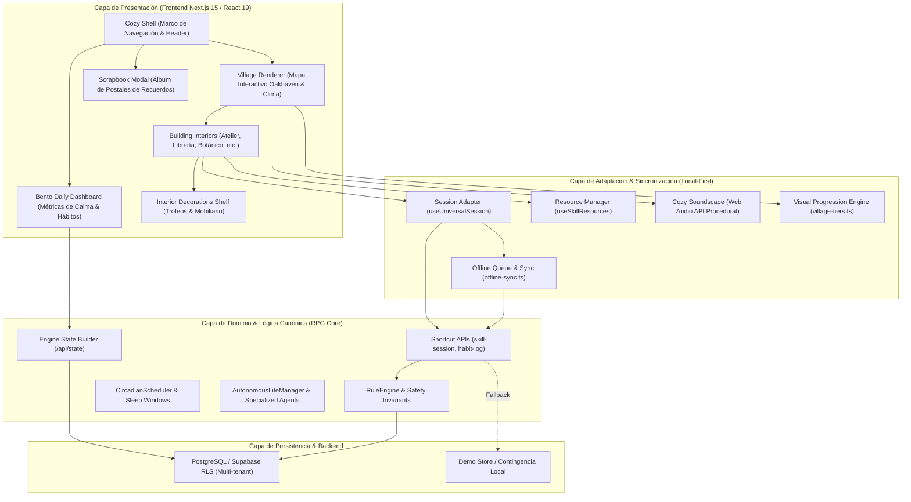
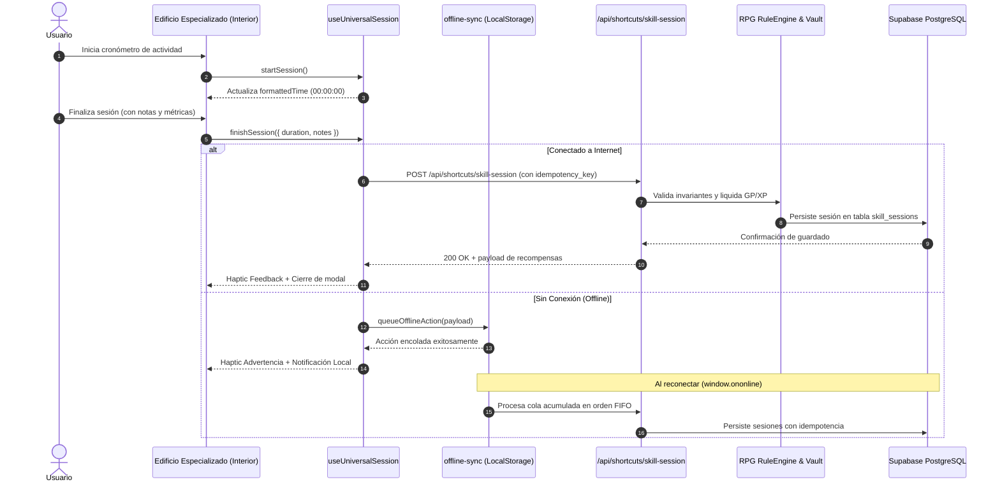

# ARQUITECTURA DEL SISTEMA — COZY LIVING VILLAGE
## RPG Life-Engine 3.5.0
**Documento Técnico:** `docs/cozy-village/ARCHITECTURE.md`  
**Versión:** 1.0.0  
**Fecha:** 10 de Noviembre de 2026  
**Estado:** Propuesta de Arquitectura — Pendiente de Aprobación

---

## 1. Visión y Principios Arquitectónicos

Cozy Living Village es la evolución del RPG Life-Engine hacia un simulador personal de desarrollo y bienestar inspirado conceptualmente en *Stardew Valley*, *Animal Crossing* y *Los Sims*, manteniendo intacta la seriedad de los datos de productividad y las matemáticas canónicas de la aplicación.

### Principios Fundamentales
1. **Separación Estricta entre Presentación y Dominio:** La estética Cozy y el pueblo pixel art representan visualmente el progreso real; no alteran fórmulas de GP, XP, niveles, racha ni reglas financieras.
2. **Cero Economías Paralelas:** No existen "monedas del pueblo", "tokens de decoración" ni costes ocultos. Las recompensas se derivan de la bóveda presupuestaria existente mediante `/api/shortcuts/skill-session`.
3. **Progresión Visual Determinista y Derivada:** Los niveles de los edificios (Tiers 1, 2 y 3), los trofeos interiores y las postales se calculan en memoria a partir del estado verificado del usuario (`EngineStateData`). Cero columnas o tablas redundantes en base de datos.
4. **Resiliencia Local First y PWA:** La aplicación debe funcionar sin degradación ante micro-cortes de conectividad mediante encolamiento idempotente (`offline-sync.ts`).
5. **Accesibilidad y Confort Sensorial:** Paisajes sonoros procedimentales nativos con Web Audio API (silenciados por defecto), soporte para `prefers-reduced-motion` y botón de "Modo Quieto".

---

## 2. Diagrama de Capas Arquitectónicas



---

## 3. Especificación de Componentes del Sistema

### 3.1. Cozy Shell (`CozyShell`)
* **Propósito:** Proveer el marco estructural compartido, la barra lateral estilo inventario RPG, el avatar interactivo del reino, el reloj circadiano en vivo y el alternador de vistas.
* **Componentes clave:**
  - `CozySidebar`: Menú con navegación semántica: Inicio (`home`), Pueblo Vivo (`village`), Misiones (`quests`), Colecciones (`collections`), Residentes (`party`), Bitácora (`notes`) y Álbum (`scrapbook`).
  - `CozyHeader`: Reloj digital, saldo visible de billetera GP y bóveda, selector de vista (Bento vs Pueblo) y acceso rápido al Álbum.

### 3.2. Dashboard Diario (`BentoDailyDashboard`)
* **Propósito:** Presentación de la jornada diaria en formato Bento sin estrés punitivo ni sobrecarga financiera.
* **Secciones:**
  - Resumen de racha y multiplicador de gracia.
  - Cantero de Hábitos Vivos (estado de riego del día).
  - Actividades y misiones activas recomendadas por el Consejo de Residentes.
  - Citas inspiradoras de bienestar y balance de esfuerzo.

### 3.3. Village Renderer (`CozyVillageMap`)
* **Propósito:** Renderizar el plano topológico del Valle de Oakhaven con estética cozy pixel art.
* **Responsabilidades:**
  - Selector de distritos: Distrito del Saber (`saber`), Artes & Oficios (`artes`), Naturaleza (`naturaleza`) y Plaza Central (`plaza`).
  - Atmósferas climáticas dinámicas (☀️ Día, 🌧️ Lluvia, 🍂 Otoño, 🌌 Noche) con adaptación de partículas CSS e iluminación de fachadas.
  - Control de paisajes sonoros procedimentales nativos mediante `cozySoundscape`.
  - Transición a pantalla completa y modal de interiores.

### 3.4. Building Registry (`buildings-registry.ts`)
* **Propósito:** Registro canónico desacoplado que asocia cada dominio de habilidad (`SkillDomain`) con su edificio, metadata visual, lore e interfaz correspondiente.

```typescript
export interface SanctuaryBuildingDefinition {
  id: string;
  domain: SkillDomain;
  name: string;
  subtitle: string;
  category: "artesania" | "intelecto" | "enfoque" | "maestria" | "bienestar";
  badge: string;
  pixelArtIcon: string;
  route: string;
  defaultMinutes: number;
  lore: string;
  specializedFeatures: string[];
  colorTheme: {
    bgMuted: string;
    borderMuted: string;
    accentSage: string;
    goldText: string;
  };
}
```

### 3.5. Building Interiors (`BuildingInteriors`)
* **Propósito:** Espacios especializados donde el usuario realiza y registra actividades reales. Cada edificio cuenta con un componente React dedicado e interactivo:
  - `AtelierBuilding`: Contador de vueltas de tejido, cálculo fraccionario de proyecto y tipos de lana.
  - `LibreriaBuilding`: Catálogo de libros, portadas, páginas leídas y frases célebres.
  - `BibliotecaBuilding`: Deep Study 50/10, materias y repetición espaciada SM-2.
  - `ClubPuzzlesBuilding`: Cronómetro WCA con retención de espacio, scrambles y Ao5/Ao12.
  - `ObservatorioBuilding`: Deep work, minimización de distracciones y sincronización Notion.
  - `BotanicalGardenBuilding`: Cantero de hábitos vivos regables y cuaderno de campo.
  - `HikingOutpostBuilding`: Bitácora de senderos (km/desnivel), checklist de mochila y cronómetro de marcha.
  - `KitchenBuilding`: Recetario consciente, tiempos de reposo y fermentación a fuego lento.

### 3.6. Session Adapter (`useUniversalSession`)
* **Propósito:** Conectar el cronómetro interactivo de cualquier edificio con el endpoint oficial `/api/shortcuts/skill-session` sin duplicación de lógica ni riesgo de desincronización.

```typescript
export interface UniversalSessionHookReturn {
  session: UniversalSessionState | null;
  isRunning: boolean;
  isPaused: boolean;
  isActive: boolean;
  elapsedSeconds: number;
  formattedTime: string;
  elapsedMinutes: number;
  startSession: (params?: Partial<StartSessionParams>) => void;
  pauseSession: () => void;
  resumeSession: () => void;
  resetSession: () => void;
  updateNotes: (notes: string) => void;
  finishSession: (params?: FinishSessionParams) => Promise<unknown>;
  submitting: boolean;
}
```

### 3.7. Resource Manager (`useSkillResources`)
* **Propósito:** Centralizar el acceso a colecciones y recursos por habilidad (libros en lectura, proyectos de tejido, arsenal de cubos Rubik, esquejes botánicos y recetas) proporcionando mutaciones optimistas y guardado seguro.

### 3.8. Visual Progression Engine (`village-tiers.ts`)
* **Propósito:** Calcular determinísticamente en memoria el Tier Visual del edificio (Tier 1 Cabaña Rústica, Tier 2 Taller Establecido, Tier 3 Santuario Maestro) y el estado desbloqueado/bloqueado del mobiliario interior a partir del esfuerzo comprobado.

```typescript
export interface BuildingVisualTier {
  tierNumber: 1 | 2 | 3;
  tierName: string;
  badge: string;
  facadeDescription: string;
  decorations: string[];
  nextMilestonePrompt?: string;
  requiredSessions: number;
}
```

### 3.9. Resident Assistant (`COZY_VILLAGE_RESIDENTS`)
* **Propósito:** Dotar de personalidad y compañía a cada espacio mediante residentes asistentes que ofrecen retroalimentación contextual y micro-misiones no punitivas con confirmación explícita (Human-in-the-Loop).

---

## 4. Contratos de Datos y Tipos TypeScript

### 4.1. Contrato de Trofeo de Mobiliario Interior
```typescript
export interface BuildingTrophyItem {
  id: string;
  name: string;
  category: "furniture" | "trophy" | "relic";
  icon: string;
  unlocked: boolean;
  requirement: string;
  flavorText: string;
}
```

### 4.2. Contrato de Residente del Pueblo
```typescript
export interface VillageResident {
  id: string;
  name: string;
  title: string;
  species: string;
  avatar: string;
  buildingId: string;
  domain: SkillDomain;
  favoriteGift: string;
  greetingQuote: string;
  microQuest?: {
    title: string;
    description: string;
    targetAction: string;
    estimatedMinutes: number;
    badge: string;
  };
  getDynamicAdvice: (context: {
    skillLevel: number;
    sessionsCount: number;
    lastSessionDetails?: string;
  }) => string;
}
```

### 4.3. Contrato de Postal del Álbum de Recuerdos
```typescript
export interface ScrapbookMemory {
  id: string;
  title: string;
  location: string;
  unlocked: boolean;
  dateUnlocked?: string;
  icon: string;
  description: string;
  polaroidColor: string;
}
```

---

## 5. Manejo de Estados de Carga, Error y Datos Vacíos

| Estado | Estrategia de Presentación | Comportamiento Técnico |
|---|---|---|
| **Cargando (`loading`)** | Skeleton loaders con marco de madera rústica y destellos suaves sin saltos de layout (CLS 0). | Mantiene la estructura del dashboard mientras `/api/state` responde. |
| **Error de Red (`error`)** | Banner no intrusivo color arcilla suave: *"Modo Desconectado: Tus avances se guardan localmente"*. | Activa automáticamente `queueOfflineAction` para retener las acciones en `localStorage`. |
| **Colección Vacía (`empty`)** | Mensaje acogedor y motivador del residente (ej. *"Aún no hay libros en tu estantería. Elige un tomo para comenzar"*). | Evita estados en blanco con botones de acción directa para crear el primer registro. |
| **Sesión Desconectada (`offline`)** | Píldora ámbar flotante en cabecera: *"Guardado offline activo"*. | Al recuperar internet (`window.ononline`), sincroniza la cola y ejecuta `triggerHaptic("success")`. |

---

## 6. Diagrama de Secuencia de Registro de Sesión


