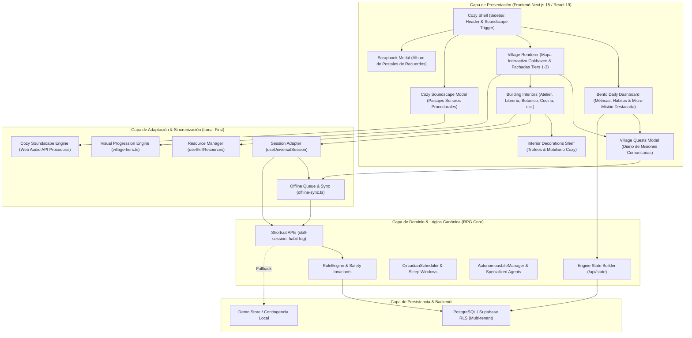

# ARQUITECTURA DEL SISTEMA — COZY LIVING VILLAGE
## RPG Life-Engine 3.5.0
**Documento Técnico:** `docs/cozy-village/ARCHITECTURE.md`  
**Versión:** 1.7.0  
**Fecha:** 11 de Noviembre de 2026  
**Estado:** Fase 8 (Skill Resource Hub & Smart Capture) Implementada & Validada en Producción

---

## 1. Visión y Principios Arquitectónicos

Cozy Living Village es la evolución del RPG Life-Engine hacia un simulador personal de desarrollo y bienestar inspirado conceptualmente en *Stardew Valley*, *Animal Crossing* y *Los Sims*, manteniendo intacta la seriedad de los datos de productividad y las matemáticas canónicas de la aplicación.

### Principios Fundamentales
1. **Separación Estricta entre Presentación y Dominio:** La estética Cozy y el pueblo pixel art representan visualmente el progreso real; no alteran fórmulas de GP, XP, niveles, racha ni reglas financieras.
2. **Cero Economías Paralelas:** No existen "monedas del pueblo", "tokens de decoración" ni costes ocultos. Las recompensas se derivan de la bóveda presupuestaria existente mediante `/api/shortcuts/skill-session`.
3. **Progresión Visual Determinista y Derivada:** Los niveles de los edificios (Tiers 1, 2 y 3), los trofeos interiores y las postales se calculan en memoria a partir del estado verificado del usuario (`EngineStateData`). Cero columnas o tablas redundantes en base de datos.
4. **Resiliencia Local First y PWA:** La aplicación funciona sin degradación ante micro-cortes de conectividad mediante encolamiento idempotente (`offline-sync.ts`) y registro en Service Worker.
5. **Accesibilidad y Confort Sensorial:** Paisajes sonoros procedimentales nativos con Web Audio API (silenciados por defecto), soporte para `prefers-reduced-motion` y controles accesibles por teclado.

---

## 2. Diagrama de Capas Arquitectónicas

---

## 3. Especificación de Componentes del Sistema

### 3.1. Cozy Shell & Header Modular (`CozyHeader`, `CozySidebar`)
* **Propósito:** Proveer el marco estructural compartido, la navegación semántica y accesos rápidos a utilidades globales.
* **Componentes clave:**
  - `CozySidebar`: Menú inventario RPG con rutas a Inicio (`home`), Pueblo Vivo (`village`), Misiones (`quests`), Colecciones (`collections`), Residentes (`party`), Bitácora (`notes`) y Álbum (`scrapbook`).
  - `CozyHeader`: Reloj circadiano digital, balances visibles de billetera y bóveda, indicador offline PWA con sync pill, acceso rápido al Álbum de Postales (`📷 Álbum`) y al selector de paisajes sonoros (`🎵 Audio`).

### 3.2. Dashboard Diario Bento (`BentoDailyDashboard`)
* **Propósito:** Presentación de la jornada diaria en formato Bento modular sin estrés punitivo ni sobrecarga financiera.
* **Secciones:**
  - **Estado del Reino (Översikt, 7 cols):** Racha de constancia, XP y desglose de billetera/bóveda.
  - **Mini Previa del Pueblo (5 cols):** Coordenadas y acceso directo al mapa interactivo.
  - **Micro-Misión Destacada de Oakhaven (12 cols, Novedad v1.2):** Tarea del día sugerida por el residente de turno con botón directo de guardado (`Registrar Avance`) y acceso al diario completo.
  - **Registro de Misiones Diarias (7 cols) & Colecciones del Santuario (5 cols).**
  - **Compañeros del Pueblo (12 cols):** Acceso a los 8 residentes asistentes.
  - **Bitácora de Notas Rápidas (12 cols):** Almacenamiento local-first de recordatorios.

### 3.3. Village Renderer & Progresión de Tiers (`CozyVillageMap`)
* **Propósito:** Renderizar el plano topológico de Oakhaven con estética cozy pixel art y evolución de fachadas.
* **Niveles Constructivos (Tiers):**
  - **Tier 1 (Cabaña Rústica 🪵):** Borde de madera `#5C4033`, chimenea con humo suave y cesta de materiales básicos.
  - **Tier 2 (Taller Establecido 🌿):** Borde verde salvia `#77936A`, toldo de lona artesanal y farol exterior cálido.
  - **Tier 3 (Santuario Maestro ⭐):** Marco dorado reforzado `#E7D69C`, cúpula de maestría, vidrieras policromadas e iluminación nocturna.
* **Herramientas de Mapa:**
  - Filtros por distritos (`artes`, `saber`, `naturaleza`, `plaza`).
  - Clima dinámico (`sunny`, `rain`, `autumn`, `night`).
  - Botón directo para la Bitácora del Alcalde (`MayorsLedgerModal`) y el Diario de Misiones (`VillageQuestsModal`).

### 3.4. Motor de Audio Procedural (`cozy-soundscape.ts`)
* **Propósito:** Generar paisajes sonoros envolventes y relajantes sin archivos MP3 pesados, 100% offline y en tiempo real usando **Web Audio API**.
* **Presets:**
  - `off`: Silencio absoluto (por defecto).
  - `rain`: Ruido rosa filtrado paso-bajo (`lowpass` a 800 Hz) que simula lluvia suave.
  - `fireplace`: Ruido de baja frecuencia con chasquidos y brasas aleatorias.
  - `breeze`: Ráfagas de viento moduladas por oscilador LFO (`0.15 Hz`).
  - `chimes`: Campanas zen con notas pentatónicas afinadas (A4, B4, C#5, E5, F#5, A5).

### 3.5. Diario de Misiones Comunitarias (`VillageQuestsModal`)
* **Propósito:** Catálogo unificado con las 8 micro-misiones diarias de los residentes de Oakhaven.
* **Funciones:**
  - Medidor de afinidad en 5 corazones (`calculateAffinity`) calculado determinísticamente por sesiones realizadas.
  - Botón `Registrar Avance` protegido por clave de idempotencia diaria.
  - Enlaces directos a los interiores de cada gremio.

### 3.6. Interactive Pixel Village & Catálogo Desacoplado (`village-buildings-registry.ts` & `cozy-village-map.tsx`)
* **Registro de Edificios:** Catálogo tipado que mapea las habilidades reales del Santuario a 9 edificios con coordenadas de mapa (x, y %), distritos (`plaza`, `saber`, `artes`, `naturaleza`), descripción, residente asignado y detector de actividad pendiente (`getPendingActivity`).
* **Edificio de Oficina (`office-building.tsx`):** Módulo dedicado al dominio `work` con sprints Pomodoro (25/50 min), seguimiento de proyectos ágiles y registro manual de horas.
* **Evaluación de Motor de Juegos:** Se analizó el uso de **Phaser vs Renderizado Híbrido SVG/CSS**. Se descartó Phaser (>1.2 MB de bundle, falta de accesibilidad semántica, incompatibilidad SSR) a favor de un lienzo SVG pixel art declarativo de ultra bajo peso (<30 KB) con caminos empedrados, colinas norte, río con ondas CSS, puentes de madera, arboledas, faroles nocturnos y soporte completo de lectores de pantalla.
* **Modo Dual de Visualización:**
  - `landscape`: Mapa panorámico interactivo con anclaje de edificios en coordenadas reales, tooltips en hover y badges de actividad viva.
  - `grid`: Cuadrícula semántica accesible para inspección rápida y navegación total por teclado.
* **Inspección y Navegación:** Modal de inspección de edificio con ficha técnica y botón de regreso claro al pueblo.

### 3.7. Interiores Especializados de Edificios (`BuildingInteriorShell` & Gremio Modules)
* **Principio de Centro de Actividad:** Cada interior es un espacio de trabajo y acción real donde el usuario comienza, continúa o audita sesiones activas, registrando progreso verificado en `/api/shortcuts/skill-session` sin modificar reglas de XP, GP ni economía.
* **Plantilla Compartida (`BuildingInteriorShell.tsx`):**
  - **Cabecera Unificada:** Icono de gremio, título temático, badge de maestría con nivel, balance visible de GP y botón accesible "← Volver al Pueblo".
  - **Métricas Específicas del Edificio:** Grilla superior bento con 3 a 4 indicadores vivos según la habilidad.
  - **Banner de Continuación Inmediata:** Detección de última sesión activa con botón de reanudación rápida con un clic.
  - **Navegación por Pestañas:** Organización modular de submodos (Sesión Activa, Catálogo/Proyectos, Recursos/Herramientas, Historial).
  - **Acción Principal Destacada:** Panel de acción primaria contextual (Temporizadores, Contadores, Flashcards SM-2).
* **Catálogo Completo de Interiores Funcionales:**
  1. **Librería (`reading`):** Catálogo de libros, wishlist de compras, lectura activa con cronómetro universal y contador de páginas, notas/citas con dictado por voz e historial.
  2. **Biblioteca (`study`):** Materias y cursos, forja y repaso de flashcards con algoritmo SM-2 (`SpacedRepetitionDuelingWidget`), sesiones de estudio e historial de repasos.
  3. **Atelier (`knitting`):** Telar digital, proyectos y patrones, inventario de fibras/materiales, contador táctil de rondas (+1, +5, -1) y galería de recuerdos.
  4. **Oficina (`work`):** Sprints Pomodoro (25/50m), gestión ágil de proyectos y tareas (Scrum/Kanban), minutas de reuniones y entregables de retrospectiva.
  5. **Observatorio (`general` / Deep Work):** Temporizador de hiperfoco (Pomodoro 25m, Profundo 50m, Flow 90m), escudo anti-distracciones con checklist reflexivo e historial de foco.
  6. **Club de Puzzles (`rubik`):** Arsenal de cubos WCA, cronómetro reglamentario con penalties (+2s/DNF), trimmed average (Ao5/Ao12), aprendizaje de algoritmos y cuaderno de lubricación/tensiones.
  7. **Invernadero Botánico (`gardening`):** Canteros vivos de hábitos, esquejes recolectados, registro de humedad y sesiones de calma botánica.
  8. **Puesto de Senderismo (`hiking`):** Rutas y senderos, kit de supervivencia, brújula de orientación y registro de caminatas/salidas al aire libre.
  9. **Cocina de Campamento (`cooking`):** Recetario culinario, despensa de ingredientes, temporizador de fuegos y preparación de banquetes del gremio.

### 3.8. Motor Universal de Sesiones de Habilidad (`universal-session-engine.ts` & `useUniversalSession`)
* **Ciclo de Vida Determinista de 8 Fases:**
  1. **Preparar (`preparing`):** Selección anticipada del recurso, objetivo y notas preliminares antes de arrancar el tiempo.
  2. **Iniciar (`running`):** Sellado de `startedAt` con marca de tiempo ISO de alta fidelidad.
  3. **Pausar (`paused`):** Apertura de pausa viva con `activePauseStartedAt` sin alterar el acumulado neta.
  4. **Reanudar (`running`):** Consolidación de la pausa en el array `pauses` con duración exacta en segundos.
  5. **Finalizar (`completed`):** Cierre de sesión, cálculo de duración neta final y forja de payload tipado.
  6. **Guardar:** Despacho con reintentos idempotentes hacia `/api/shortcuts/skill-session` e inserción en el búfer histórico local (`rpg_universal_sessions_history_v4`).
  7. **Recuperar (Hidratación):** Reconstrucción instantánea tras recarga o cambio de pestaña con deducción matemática de pausas, cero desfase (0 drift) por suspensión de CPU.
  8. **Consultar Historial:** Acceso local e integrado a las últimas 50 sesiones por habilidad para consulta offline y trazabilidad.
* **Datos Comunes Estandarizados (`UniversalSessionRecord`):**
  - Identidad: `sessionId`, `userId`, `idempotencyKey` determinista (`ses_univ_<userId>_<sessionId>`).
  - Contexto: `domain`, `buildingId`, `projectId`, `projectName`, `resourceId`, `resourceTitle`, `sessionObjective`.
  - Cronología: `preparedAt`, `startedAt`, `endedAt`, `pauses` (`started_at`, `ended_at`, `duration_seconds`).
  - Estado y Métricas: `status` (`preparing | running | paused | completed | cancelled`), `elapsedSeconds`, `notes`, `evidenceUrls`.
  - Trazabilidad: `historyLog` con marcas de auditoría de cada transición de estado.
* **Especialización Tipada por Dominio:**
  - `reading`: `book_id`, `book_title`, `pages_read`, `quote_text`, `quote_page`, `quotes_list`.
  - `knitting`: `project_id`, `pattern_name`, `rounds_completed`, `rows_completed`, `yarn_details`, `technique`, `stitches_notes`.
  - `study`: `subject`, `topic`, `study_method`, `exercises_completed`, `comprehension_rating`, `cards_reviewed`.
  - `work`: `work_project_name`, `project_id`, `task_id`, `task_title`, `deliverable`, `impact_level`.
  - `general` / Deep Work: `sessionObjective`, `focus_rating`, `distractions_count`, `distraction_logs`.
  - `rubik`: `cube_id`, `cube_model`, `solve_time_seconds`, `penalty`, `algorithm_learned`, `ao5_seconds`.
* **Seguridad, Aislamiento y Reglas de Oro:**
  - **Aislamiento Multi-Usuario:** `hydrateUniversalSession` valida que el `userId` almacenado coincida con la sesión activa; cualquier intento de acceso cruzado devuelve `null`.
  - **Prevención de Duplicados:** Candado de sesión activa con advertencia ante colisiones entre edificios y clave de idempotencia persistente.
  - **Cero Emisión Paralela de XP/GP:** El motor frontend **no calcula ni genera GP, XP ni niveles**; únicamente reporta la duración neta real y el progreso físico verificado al backend canónico.

### 3.9. Bóveda de Recursos & Captura Inteligente (`SkillResourceHubPanel` & `SmartCaptureWidget`)
* **Objetivo de Eficiencia:** Minimizar la carga cognitiva y el tecleo manual durante las sesiones activas, derivando automáticamente el contexto de progreso y permitiendo adjuntar materiales de referencia.
* **Tipología Unificada de Recursos (`SkillResource`):**
  - Soporta vinculación de Libros (`book`), Documentos PDF (`pdf`), Videos tutoriales (`video`), Enlaces web (`link`), Patrones de artesanía (`pattern`), Imágenes y diagramas (`image`), Apuntes rápidos (`note`), Materiales (`material`) y Plantillas (`template`).
  - Validación de seguridad estricta: límite infranqueable de 5 MB (`MAX_FILE_SIZE_BYTES`), filtrado por lista blanca MIME (`image/*`, `application/pdf`, `text/*`) y sanitización de nombres de archivo contra caracteres peligrosos.
  - Aislamiento Local-First Multi-Usuario: Bóveda persistida bajo prefijo unívoco por usuario (`rpg_skill_resources_v4_<userId>`).
* **Captura Inteligente Contextual (Smart Capture):**
  - **Valores Sugeridos Deterministas:**
    - *Atelier:* Recuerda la última ronda tejida y sugiere avanzar a la siguiente (`last_round + 1` o bloques de 5), calcula el % de avance del proyecto y ofrece snippets frecuentes ("Punto bobo parejo", "Cambio de ovillo").
    - *Librería:* Sugiere páginas restantes respetando el ritmo del lector (`read_pages + 15`), autocompleta el libro en curso y facilita captura de citas con número de página.
    - *Biblioteca:* Recuerda la materia/tema activo y detecta automáticamente si hay tarjetas SM-2 vencidas pendientes de repaso.
    - *Oficina:* Presenta la siguiente tarea pendiente del backlog de sprint ágil (Scrum/Kanban) con botón de 1 clic para iniciar.
  - **Captura Multimodal (Voz y Fotografías):**
    - Dictado accesible por voz mediante Web Speech API (`SpeechRecognition`) con indicador visual de escucha en tiempo real.
    - Carga y previsualización de evidencias fotográficas (fotos de tejido en bastidor, notas de campo) adjuntadas de forma segura a la sesión universal.
  - **Confirmación Humana Previa (HITL — Human-in-the-Loop):**
    - Todo snippet o comando dictado analizado heurísticamente por `parseSmartCaptureSnippet` despliega un banner de confirmación previa con los valores detectados (ej. "25 páginas", "vuelta 18"), requiriendo que el usuario presione `Confirmar y Aplicar` antes de alterar el estado.
* **Integración sin Modificación de Reglas:** Reutiliza las estructuras de `/api/shortcuts/skill-session` sin crear servicios externos costosos ni alterar balances de economía o niveles.

---

## 4. Garantías de No Regresión e Invariantes

1. **Invariante Financiera:** Ninguna interacción o decoración genera GP arbitrario; toda recompensa se valida contra la Bóveda del usuario.
2. **Invariante de Idempotencia:** Las micro-misiones y sesiones emplean prefijos unívocos (`village_journal_<id>_<date>_<ts>`).
3. **Accesibilidad Sensorial:** El audio nunca se inicia automáticamente; respeta el gesto deliberado del usuario y las directivas de `prefers-reduced-motion`.
