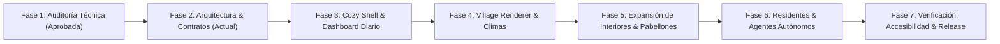

# PLAN DE IMPLEMENTACIÓN Y MIGRACIÓN GRADUAL
## Cozy Living Village — RPG Life-Engine 3.5.0
**Documento Técnico:** `docs/cozy-village/IMPLEMENTATION_PLAN.md`  
**Versión:** 1.0.0  
**Fecha:** 10 de Noviembre de 2026

---

## 1. Estrategia de Migración y Filosofía Gradual

La evolución hacia Cozy Living Village sigue un enfoque **incremental, reversible y libre de riesgo**, fundamentado en:
1. **Coexistencia Continua:** El dashboard táctico original `/dashboard` se mantiene operativo al 100% durante todo el ciclo de vida del proyecto.
2. **Cero Migraciones Destructivas de Base de Datos:** Toda la nueva riqueza visual (tiers, muebles, postales) se calcula en memoria o se almacena en el cliente.
3. **Validación Continua:** Cada fase se valida mediante la suite automatizada de pruebas (`npm test`) y la compilación completa de producción (`npm run build`).

---

## 2. Cronograma de Fases de Desarrollo



---

### Fase 1: Auditoría Técnica y Diagnóstico de Compatibilidad *(COMPLETADA)*
* **Objetivo:** Inspeccionar el repositorio, versiones reales, dependencias, rutas y catalogar los 14 dominios de habilidad del Santuario.
* **Entregables Producidos:**
  - `docs/cozy-village/CURRENT_STATE.md`
  - `docs/cozy-village/SKILLS_INVENTORY.md`
  - `docs/cozy-village/COMPATIBILITY_AUDIT.md`
* **Resultado:** Auditoría aprobada, 44/44 tests pasando, cero secretos expuestos.

---

### Fase 2: Arquitectura, Contratos Tipados y Mapeo de Rutas *(FASE ACTUAL)*
* **Objetivo:** Diseñar la arquitectura técnica de Cozy Living Village, los contratos de TypeScript, la topología de navegación y el plan de migración.
* **Entregables:**
  - `docs/cozy-village/ARCHITECTURE.md`
  - `docs/cozy-village/ROUTE_MAP.md`
  - `docs/cozy-village/IMPLEMENTATION_PLAN.md`
* **Criterio de Aceptación:** Aprobación explícita del usuario antes de proceder a la Fase 3.

---

### Fase 3: Cozy Shell y Dashboard Diario Unificado
* **Objetivo:** Pulir y refinar la capa de presentación de `/cozy` mediante componentes modulares en `src/components/cozy/`.
* **Actividades:**
  1. Extraer la barra de navegación lateral hacia `src/components/cozy/cozy-sidebar.tsx`.
  2. Extraer la cabecera del reino hacia `src/components/cozy/cozy-header.tsx`.
  3. Optimizar el rendimiento de la vista Bento (`src/components/cozy/bento-daily-dashboard.tsx`).
  4. Implementar skeleton loaders de madera rústica para mitigar cualquier parpadeo de carga (CLS 0).
* **Pruebas:** Verificar tiempo de carga inferior a 1.5s y cero fallos en re-renders.

---

### Fase 4: Village Renderer, Clima y Paisajes Sonoros Procedurales
* **Objetivo:** Consolidar el plano interactivo de Oakhaven y la atmósfera sensorial.
* **Actividades:**
  1. Mantener la persistencia en `localStorage` del clima (`oakhaven_weather_pref`) y audio (`oakhaven_sound_muted_pref`).
  2. Ajustar el motor `cozySoundscape` con modulación de volumen suave (fade-in / fade-out) al cambiar de estación o clima.
  3. Asegurar que el interruptor de "Modo Quieto" congele todas las partículas CSS para respetar `prefers-reduced-motion`.
* **Pruebas:** Validación de audio Web Audio API en modo suspendido/reactivado y ausencia de consumo de CPU inactivo (<1%).

---

### Fase 5: Expansión de Interiores y Pabellones Especializados
* **Objetivo:** Culminar la especialización de los 6 pabellones complementarios restantes del Santuario.
* **Actividades:**
  1. **Taller de Ilustración & Bocetos** (`drawing`): Cronómetro de dibujo rápido y galería de estudios sin perfeccionismo.
  2. **Taller de Arcilla & Alfarería** (`ceramics`): Registro de piezas, tiempos de secado y horneado.
  3. **Santuario Zen & Journaling** (`journaling`): Preguntas reflexivas del día y victorias libres de culpa.
  4. **Salón Arcade Consciente** (`gaming`): Alarma anti-tilt a los 40 minutos de partida.
  5. **Dojo de Acondicionamiento** (`sports`): Control de esfuerzo percibido y vigor físico.
  6. **Oficina Estratégica** (`work`): Tablero Kanban interactivo conectado a las tareas existentes.
* **Pruebas:** Comprobar que cada nuevo edificio consuma `useUniversalSession` sin crear endpoints redundantes.

---

### Fase 6: Residentes Asistentes y Agentes Autónomos (HITL)
* **Objetivo:** Conectar el consejo de residentes con el sistema multiagente existente (`AutonomousLifeManager`).
* **Actividades:**
  1. Conectar las sugerencias de los residentes (Barnaby, Tara, Oliver, Clara, Eldrin) con el `DailyPlannerAgent`.
  2. Asegurar que las micro-misiones no impongan castigos ni reduzcan racha en caso de no ser completadas.
  3. Respetar siempre el principio Human-in-the-Loop (el usuario debe presionar "Aceptar" explícitamente).
* **Pruebas:** 7 pruebas unitarias de integración de diálogo y generación de misiones en `tests/`.

---

### Fase 7: Verificación, Accesibilidad y Release
* **Objetivo:** Auditoría de calidad, rendimiento y accesibilidad antes del cierre definitivo de versión.
* **Actividades:**
  1. Auditoría Lighthouse (Performance > 90, Accessibility > 95, Best Practices 100).
  2. Comprobación de contrastes WCAG AA en modo día y noche.
  3. Validación de la PWA offline con desconexión física de red y simulación en Chrome DevTools.
  4. Compilación de producción limpia (`npm run build`) y ejecución completa de los 44+ tests (`npm test`).

---

## 3. Matriz de Dependencias entre Componentes

```
[CozyShell]
   ├── [CozySidebar]
   ├── [CozyHeader]
   ├── [BentoDailyDashboard]
   └── [CozyVillageMap]
           ├── [InteriorDecorationsPanel]
           ├── [MayorsLedgerModal]
           ├── [VillageScrapbookModal]
           ├── [cozySoundscape] (Web Audio API)
           └── [BuildingInteriors (8 edificios)]
                   └── [useUniversalSession]
                           └── [offline-sync]
                                   └── [/api/shortcuts/skill-session]
```

---

## 4. Estrategia de Pruebas y Criterios de Aceptación

| Nivel de Prueba | Herramienta | Alcance | Criterio de Éxito |
|---|---|---|---|
| **Pruebas Unitarias** | Node.js Test Runner | Lógica de tiers, racha, invariantes de bóveda, deduplicación e idempotencia. | 100% de tests aprobados (0 fallos). |
| **Pruebas de Tipado** | TypeScript Compiler (`tsc`) | Contratos estrictos de componentes, props, eventos y tipos del motor RPG. | Cero errores de compilación (`tsc --noEmit`). |
| **Compilación de Producción** | Next.js 15 (`next build`) | Generación estática y dinámica de las 27 rutas del proyecto. | Código de salida 0 con traces optimizados. |
| **Prueba de Red Local-First** | `offline-sync.ts` | Encolamiento de peticiones sin internet y sincronización automática. | Cero pérdida de registros al recuperar conexión. |
