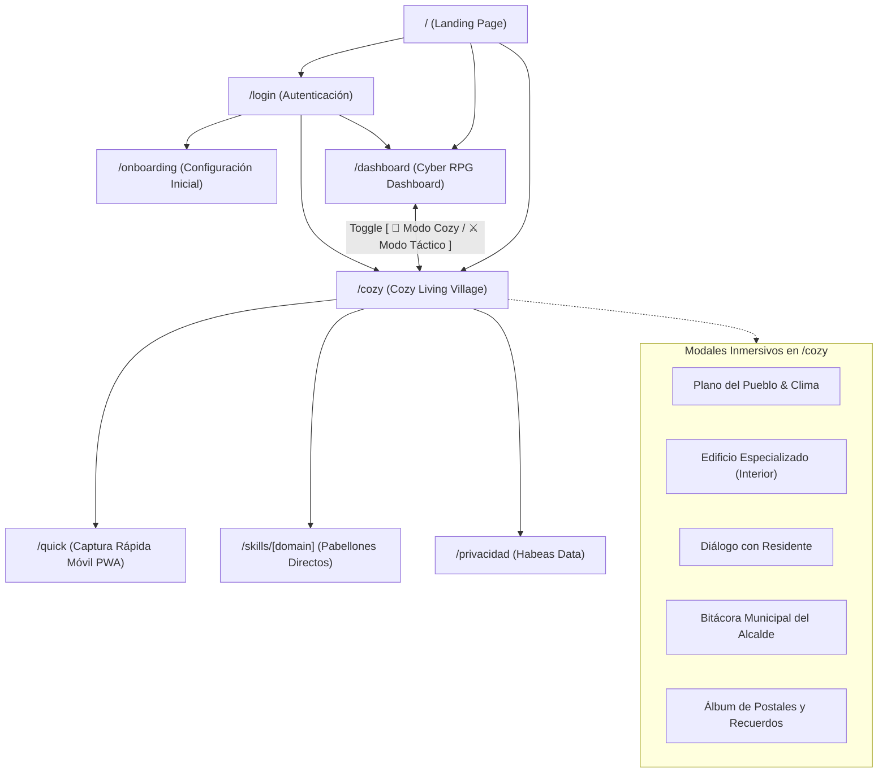

# MAPA DE RUTAS Y NAVEGACIÓN — COZY LIVING VILLAGE
## RPG Life-Engine 3.5.0
**Documento Técnico:** `docs/cozy-village/ROUTE_MAP.md`  
**Versión:** 1.0.0  
**Fecha:** 10 de Noviembre de 2026

---

## 1. Topología General de Navegación

El sistema mantiene una coexistencia armoniosa entre la vista cyberpunk/RPG de alto rendimiento (`/dashboard`) y el pueblo sereno de fantasía cálida (`/cozy`), compartiendo la misma sesión de usuario, el mismo estado del motor (`/api/state`) y los mismos endpoints de persistencia.

---

## 2. Inventario Detallado de Rutas Frontend

### 2.1. Páginas Principales

| Ruta | Archivo Fuente | Propósito | Estrategia de Render | Seguridad / Auth |
|---|---|---|---|---|
| `/` | `src/app/page.tsx` | Presentación del proyecto, acceso directo y switch de inicio. | Estática (`○ Static`) | Pública |
| `/cozy` | `src/app/cozy/page.tsx` | **Valle de Oakhaven:** Tablero Bento, mapa interactivo, interiores de edificios, clima y bitácora. | Estática (`○ Static`) | Redirige a `/login` si no autenticado (401) |
| `/dashboard` | `src/app/dashboard/page.tsx` | **Dashboard Original:** AI Command Center, finanzas Looker Studio, Debt Bosses y Árbol de Talentos. | Estática (`○ Static`) | Redirige a `/login` si no autenticado (401) |
| `/quick` | `src/app/quick/page.tsx` | PWA optimizada para registro ultra-rápido en smartphones (gastos, hábitos, sesiones). | Estática (`○ Static`) | Requiere sesión activa |
| `/login` | `src/app/login/page.tsx` | Acceso con credenciales seguras, Magic Link y botón de acceso instantáneo (Modo Demo). | Estática (`○ Static`) | Pública |
| `/onboarding` | `src/app/onboarding/page.tsx` | Asistente conversacional con IA para calibrar objetivos, misiones y presupuesto. | Estática (`○ Static`) | Requiere sesión activa |
| `/privacidad` | `src/app/privacidad/page.tsx` | Política de Tratamiento de Datos, Habeas Data y consentimiento obligatorio. | Estática (`○ Static`) | Pública |
| `/manifest.webmanifest`| `src/app/manifest.ts` | Manifiesto PWA para instalación en iOS y Android con icono pixel art. | Dinámica (`ƒ Dynamic`) | Pública |

### 2.2. Rutas Dinámicas de Habilidad (`/skills/[domain]`)

La ruta `src/app/skills/[domain]/page.tsx` resuelve dinámicamente el dominio solicitado y renderiza la experiencia especializada del Santuario:

| Dominio (`[domain]`) | Edificio Vinculado | Componente Especializado | Residente |
|---|---|---|---|
| `/skills/knitting` | El Atelier de Hilados | `AtelierBuilding` | Clara la Oveja |
| `/skills/reading` | La Librería & Archivo | `LibreriaBuilding` | Eldrin el Búho |
| `/skills/study` | La Biblioteca del Erudito | `BibliotecaBuilding` | Lyra la Gata |
| `/skills/rubik` | Club de Speedcubing | `ClubPuzzlesBuilding` | Milo la Nutria |
| `/skills/general` | Observatorio Cósmico | `ObservatorioBuilding` | Aura la Zorra Estelar |
| `/skills/gardening` | Invernadero Botánico | `BotanicalGardenBuilding` | Barnaby el Tejón |
| `/skills/hiking` | Puesto de Senderismo | `HikingOutpostBuilding` | Tara la Zorra Montañesa |
| `/skills/cooking` | Cocina & Alquimia | `KitchenBuilding` | Oliver el Erizo Panadero |
| `/skills/work` | Oficina Estratégica | `AtelierBuilding` / Kanban | Aura la Zorra |
| `/skills/drawing` | Taller de Ilustración | Pabellón en Expansión | Residente Asignado |
| `/skills/ceramics` | Taller de Arcilla | Pabellón en Expansión | Residente Asignado |
| `/skills/journaling`| Santuario Zen | Pabellón en Expansión | Residente Asignado |
| `/skills/gaming` | Salón Arcade Consciente| Pabellón en Expansión | Residente Asignado |
| `/skills/sports` | Dojo de Vigor Físico | Pabellón en Expansión | Residente Asignado |

*Nota de Compatibilidad:* Si un usuario accede a una URL directa `/skills/[domain]`, la página cuenta con un botón de retorno rápido hacia `/cozy` manteniendo la continuidad de la sesión.

---

## 3. Inventario de Endpoints API Backend

Todos los endpoints API responden en JSON con encabezados de seguridad estrictos (`X-Frame-Options: DENY`, `X-Content-Type-Options: nosniff`):

### 3.1. Estado y Ciclo de Vida
* `GET /api/state`: Retorna el estado consolidado del jugador (`EngineStateData`), incluyendo saldo GP de billetera y bóveda, racha, nivel, misiones, libros de lectura, proyectos de tejido, estadísticas Rubik y sesiones recientes.
* `GET /api/health`: Healthcheck del servidor y verificación de conectividad a la base de datos PostgreSQL.

### 3.2. Autenticación y Sesiones
* `POST /api/auth/login`: Autenticación contra Supabase Auth emitiendo cookies HTTP-only protegidas.
* `POST /api/auth/logout`: Invalidación de cookies de sesión y redirección.
* `GET /api/auth/demo`: Creación de sesión instantánea aislada en memoria/cookie para pruebas y demostración.

### 3.3. Atajos de Captura Rápida (Shortcuts API)
* `POST /api/shortcuts/skill-session`: Registro seguro de sesiones de habilidad con `idempotency_key`, validación de duración e impacto en GP/XP.
* `POST /api/shortcuts/habit-log`: Registro de hábitos completados, riego botánico y mantenimiento de racha.
* `POST /api/shortcuts/quick-expense`: Deducción de gastos cotidianos y daño pasivo contra jefes de deuda.
* `POST /api/shortcuts/receipt-scan`: Procesamiento OCR y parsing con IA Gemini de tiques y facturas.
* `POST /api/shortcuts/boss-counterattack`: Reducción de deuda mediante pagos extraordinarios.
* `GET /api/shortcuts/widget-summary`: Telemetría consolidada para widgets de iOS (Scriptable) y Android, incluyendo ahora el bloque `cozy_village`.

---

## 4. Estrategia de Deep-Linking y Transición de Vistas

### 4.1. Toggle de Experiencia
El usuario puede cambiar entre `/dashboard` y `/cozy` en cualquier momento mediante el botón de conmutación:
- En `/dashboard`: Botón destacado `[ 🌾 Modo Cozy RPG ]` que navega hacia `/cozy`.
- En `/cozy`: Botón `[ 📊 Tablero Bento ]` que alterna internamente entre la vista de tarjetas y el mapa del pueblo, o navega hacia `/dashboard` para análisis financiero avanzado.

### 4.2. Persistencia de Parámetros en URL y LocalStorage
- `activeBuildingModal`: Se gestiona como estado React local o parámetro query opcional (`/cozy?building=atelier`), lo que permite compartir enlaces directos hacia el interior de un edificio.
- `oakhaven_weather_pref`: Se almacena en `localStorage` con valores `"sunny" | "rain" | "autumn" | "night"`.
- `oakhaven_sound_muted_pref`: Se almacena en `localStorage` con valores `"true" | "false"`.
