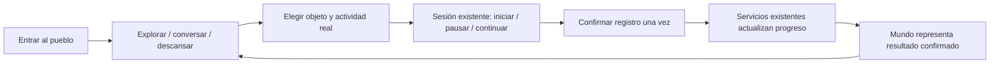

# OakHaven 5.0 — Game Design Document

Estado: propuesta, no implementación. Fecha: 11 de noviembre de 2026, America/Bogota. Base inspeccionada: `main`, commit `013def1c03e9d17197d474c9abaa72912beeba85`. Esta fase solo crea documentos y actualiza continuidad. No instala dependencias, modifica reglas/auth ni ejecuta migraciones.

Actualización del ciclo posterior: **G00 corregida y probada localmente**, sin despliegue; detalles en [backlog](IMPLEMENTATION_BACKLOG.md). La auditoría siguiente describe el baseline original y conserva sus referencias históricas. Las demás capacidades 5.0 siguen siendo diseño, no implementación.

Actualización G01: existe un paseo aislado en `/play` con plaza, personaje y puerta/interior; [evidencia y límites](G01_SPIKE_RESULTS.md). No conecta aún personaje autenticado, actividades, progresión ni economía. El recorrido completo del GDD sigue siendo objetivo, no una capacidad ya terminada.

## Visión y alcance

Actualización Prompt 0.1: se mantiene el recorrido registro → creador omisible → introducción breve → plaza → Atelier/bastidor → actividad real confirmada → progreso amable → regreso al pueblo. Para cuentas existentes, el creador ofrece completar después y conserva identidad e historial. El paseo G01 solo acredita exploración aislada; este recorrido completo aún requiere las puertas de seguridad/datos del backlog. La [matriz de trazabilidad](NOOKERY_ADAPTATION_STUDY.md#8-trazabilidad-del-prompt-01) enlaza mecánicas, reutilización, riesgo y aceptación sin otro plan paralelo. La personalización visual no concede GP/XP y el acceso rápido evita obligar a caminar para registrar.

Un refugio personal donde el jugador habita un pueblo, elige actividades reales y contempla lo que ha construido. El juego es la entrada principal; proyectos, registros y finanzas son servicios que se consultan en lugares concretos. Caminar, conversar y descansar tienen valor propio y nunca otorgan dinero ficticio.

La diferencia respecto al dashboard actual es estructural: el personaje atraviesa espacios, se acerca a objetos, decide una acción y observa una consecuencia persistente cuando la actividad real se confirma. Un mueble no es una tarjeta con otra decoración. El primer corte tiene una plaza y un Atelier; el resto del pueblo puede seguir accediendo a herramientas existentes mientras se transforma por etapas.

Pilares:

1. Presencia: posición, orientación, transición entre exterior/interior y habitantes con rutinas simples.
2. Elección tranquila: tutorial omisible, controles accesibles, pausa, sin urgencia artificial, castigos nuevos por ausencia ni recompensas por estar conectado.
3. Consecuencia creíble: una sesión registrada alimenta la progresión existente y su representación en obra, mobiliario o recuerdos.
4. Continuidad: misma cuenta, misma historia, mismas reglas; cambiar apariencia no reinicia nada.
5. Herramientas a mano: inventario visual y HUD discreto; captura rápida conserva una ruta directa para uso cotidiano.

Fuera del primer corte: multijugador, combate nuevo, mercado, monedas/materiales consumibles nuevos, pagos bancarios, generación continua con IA, simulación completa de todos los edificios y reescritura del backend.

## Auditoría de base contrastada con código

Se hizo una revisión dirigida; no se repitió la auditoría completa ni se tomó por cierta la etiqueta 4.4 de los informes. Referencias al árbol observado:

| Sistema | Existencia real | Límite / consecuencia para 5.0 |
|---|---|---|
| Frontend | Next App Router, React, TS, Tailwind; `app/dashboard/page.tsx:1`, `app/cozy/page.tsx:1` montan dos dashboards | No hay cliente de juego aislado; añadir `/play` sin reemplazar rutas de recuperación |
| Auth y usuarios | `app/api/auth/login/route.ts:29–231`: Supabase o registro local; cookies servidor | No cambiar identidad. Bloqueo crítico G-SEC-01 antes de ampliar registro |
| Perfil | `types/rpg.ts:527–548`: ID, nombre, clase, avatar y configuración | No hay descriptor de sprite ni estado de creador de personaje |
| Onboarding | `app/onboarding/page.tsx:131,794–807`: cinco pasos y salida a dashboard | Mezcla configuración personal y finanzas; no reutilizar para actualizar cosméticos |
| Onboarding backend | `app/api/onboarding/route.ts:103,167–207,252,297,325` aplica configuración, upserts y reemplazos | Puede reinicializar progreso y borrar/recrear colecciones; G-DATA-01 |
| Habilidades | `world-preferences-engine.ts:26–45,61–97` activa/pausa/archiva; catálogos estables de edificios | Adaptar preferencias sin borrar sesiones; defaults no son elección explícita del jugador |
| RPG / misiones | `demo-store.ts:2184–2275`, `agents/dynamic-quest.ts`; `schema.sql:423–486` | Store y SQL tienen reglas. La escena no calcula otro GP/XP ni crea premios tutoriales |
| Sesiones | `universal-session-engine.ts:120–160,176,243,475,521` modela tiempo, pausas y clave | Buen núcleo reutilizable; hook actual tiene defaults de usuario y confirmación insuficiente |
| Guardado de sesión | `use-universal-session.ts:356–390` hace fetch, lee JSON y resetea; no comprueba `res.ok` en ese bloque | Un 503 JSON puede parecer resultado; corregir antes de actividades reales de 5.0 |
| Motor financiero | `bank-engine`, `financial-core`, `debt-engine`, tesorería SQL y handlers | Mantener servicios; no exponer el fixture del Banco como saldo personal verificado |
| Render | `interactive-village-scene.tsx:41–42,247–292,465`: DOM/SVG y transform CSS | Cámara y edición, sin avatar/mundo físico; WASD mueve cámara |
| Interiores | `living-interior-room.tsx:22–45,247–270`; modal en `cozy-rpg-dashboard.tsx:541` | Estaciones seleccionan paneles; no son aún habitaciones transitables |
| Compañeros | `cozy-residents-engine.ts:287`, `village-tiers.ts`, siete clases en `lib/agents` | Consejos/rutinas lógicas; roles anunciados no prueban workers ni movimiento autónomo |
| Persistencia | `persistence-sync.ts:76–158,177`; Supabase + disco + browser | Mejoras de snapshot ya existen; no confundir respaldo local con autoridad compartida |
| Offline | `offline-sync.ts:65–112,132–193`, `public/sw.js:71` | SW 503 ya corregido; copia global y llamadas sin propietario requieren resolver aislamiento |
| Pruebas | Suite de motores y recorridos sintéticos | No certifican recorrido en navegador, DB real ni rendimiento móvil |

### Bloqueos nuevos o decisivos para el plan

- **G-SEC-01, P0 condicional:** `app/api/auth/login/route.ts:87–101` puede actualizar contraseña de una cuenta encontrada tras error de registro duplicado, usando cliente admin, sin acreditar previamente propiedad. El riesgo depende de service role/rama ejecutable; se identificó por código, no se intentó tomar ninguna cuenta. No modificar auth en esta fase. Antes de ampliar acceso, corregir esa rama y probar con proveedor simulado; esto es un arreglo acotado, no una reescritura.
- **G-DATA-01, P0:** el endpoint actual de onboarding no es un editor de avatar seguro: restaura campos iniciales de tesorería y reemplaza datos. El creador tendrá escritura separada y nunca llamará `applyOnboarding` ni reenviará el formulario financiero para usuarios existentes.
- **G-SESSION-01, P1:** finalización debe mantener pendiente ante error HTTP o respuesta sin confirmación y no convertir cero tiempo real en un minuto recompensado. El builder actual redondea y usa mínimo de un minuto (`universal-session-engine.ts:525`); el tutorial de práctica no lo invoca.
- Persisten como puertas del piloto con datos: S-001, D-005 y R-004 de la auditoría previa. Otros defectos financieros, como D-002/D-003, impiden declarar lista la aplicación completa; quedan fuera del corte espacial sin pagos ni canjes.

### Qué significa realmente 4.4

Existe código de catálogo/edificios, sesión universal, tiers, progresión visual por hitos, preferencias por habilidad y consejos contextuales. `tests/living-world-experience-44.test.ts` comprueba datos, reglas y funciones; no conduce un personaje por una escena. No se encontró un avatar controlable, colisiones de personaje, navegación de habitantes ni creador de sprite en los módulos inspeccionados. Por eso 5.0 añade un cliente de juego, sin desechar esos motores.

### Verificación realizada en esta fase

Comando: `node --test tests/rpg-engine.test.ts tests/cozy-design-system.test.ts tests/cozy-village-expansion.test.ts tests/village-world-40.test.ts tests/village-interactive-camera.test.ts tests/village-living-buildings.test.ts tests/living-world-experience-44.test.ts tests/oakhaven-45-user-journeys.test.ts`.

Resultado actual: **103 pruebas aprobadas, 0 fallos**, ocho archivos. Se revisaron antes por operaciones de archivo/red; no se ejecutó el test que escribe/borrar snapshots locales. Hay advertencias de tipo de módulo de Node. No se repitió build/lint/TypeScript por ser un cambio documental; resultados históricos no se presentan como actuales. No se probaron navegador, servicios externos, RLS desplegada ni credenciales reales.

## Ciclo principal

Exploración, diálogo, apariencia y tutorial no emiten eventos recompensables. Al descansar no se crea gasto, deuda, pérdida de XP ni penalización nueva. No se maquillan las reglas financieras históricas: cualquier tensión detectada con rachas/penalizaciones existentes se documenta y trata en una decisión económica separada, nunca se corrige desde animaciones.

## Primer recorrido jugable: «Un rincón para tu primera obra»

Piloto concreto con Atelier porque ya existen proyectos, contador, sesión y proyección de obra. Es un itinerario de prueba, no una obligación de tejer para todos los usuarios. En producción se puede omitir y escoger una habilidad activa; no se reactiva una habilidad pausada sin decisión explícita.

| Momento | Jugador y mundo | Servicio / efecto permitido |
|---|---|---|
| Llegada | Personaje en plaza, cámara lo sigue; guía breve con «Explorar» y «Omitir» | Leer perfil/proyección sin premios |
| Desplazamiento | Teclas o toque llevan por sendero; paredes/agua bloquean sin castigo | Estado espacial, sin transacción RPG |
| Puerta | Cerca del Atelier aparece «Entrar»; transición conserva orientación/contexto | Cambiar escena, no finalizar sesión |
| Habitante | Clara saluda y señala bastidor; diálogo de dos frases, omisible | Consejo determinista; no llamada LLM necesaria |
| Bastidor | Elegir proyecto existente; si no hay uno, crear mediante comando existente sin compra | Validar propiedad del recurso; ningún proyecto ficticio automático |
| Actividad | Iniciar sesión real; HUD muestra estado y pausa; jugador puede alejarse/cerrar | Una única sesión universal fuera del lifecycle de escena |
| Registro | Al terminar, confirmar duración/avance real; «Guardar» crea un único comando | Clave estable; GP/XP exactamente según servicio existente |
| Respuesta | Bastidor refleja avance; obra terminada solo si se confirma su hito real | Proyección desde datos, no segundo premio |
| Regreso | Salir a plaza; personaje y mundo conservan progreso; descanso disponible | Persistir posición segura; no actividad extra |

Meta de diseño: 2–4 minutos para creador/introducción/exploración; la actividad dura lo que la persona decida según reglas válidas existentes. No acelerar reloj real para completar la demo. En pruebas usar reloj simulado y backend sintético; los datos de prueba nunca se mezclan con cuenta real.

Si el usuario omite configuración financiera puede explorar y practicar controles, pero **no se inventa bóveda, ingreso ni GP**. La primera actividad recompensada requiere servicios correctamente configurados y confirmación durable. La práctica tutorial se representa solo como aprendizaje, no como sesión real que luego se «convierte» en premio.

## Mundo y objetos

Top-down 2D con arte pixel original. Primer mapa pequeño, plaza, sendero y un interior; no obligar a caminar distancias largas para registrar algo. Objetos del piloto: puerta, bastidor, estantería y asiento. Puerta cambia escena; bastidor inicia/retoma actividad; estantería refleja obras confirmadas; asiento ofrece pausa ambiental sin alterar reloj de sesión salvo acción explícita.

Habitantes iniciales siguen estados sencillos: en taller, desplazándose por ruta autorizada, conversando. No necesitan simular vida fuera de pantalla cada frame: horario determinista y punto seguro al volver. Las conversaciones no bloquean accesos ni contienen exigencias para «no decepcionar» al residente.

## HUD, accesibilidad y bienestar

HUD: acción próxima, sesión activa/pendiente y acceso a pausa/ayuda; XP/GP consultables en ficha, sin tablero contable permanente. Una actividad ofrece controles DOM etiquetados; el espacio permanece visible cuando sea útil, sin pila de modales. Teclado y toque, tamaño táctil mínimo objetivo 44 CSS px, foco correcto y lista alternativa de lugares/objetos con mismas acciones.

Movimiento sin precisión exigente, interacción explícita y accesible; ningún mensaje depende solo de color, sonido o vibración. Reduced motion elimina sacudidas/transiciones; audio apagado inicialmente. Sin recompensas por rachas de conexión ni sanción por saltar tutorial o descansar. Reanudar pregunta «¿Quieres continuar?» en vez de «Perdiste tu oportunidad».

## Arte y costos

Arte propio o assets con licencia verificada y registro de procedencia. La referencia cozy orienta calidez, ritmo y legibilidad, no reproduce personajes, mapas, música, UI ni sprites de otro juego. Prototipo con formas/sprites originales básicos antes de comprar o generar packs. No se crea ni solicita arte en esta fase.

## Criterio de éxito

Un usuario existente entra con su mismo ID, personaliza o pospone, se mueve, entra al Atelier, inicia una sola actividad, puede salir/volver y confirma un solo resultado; el objeto y su ficha muestran el mismo progreso incluso al recargar. Elegir «Descansar», visitar o repetir un diálogo no cambia GP/XP. Foco y controles permiten ese recorrido sin puntero. Medir comprensión y carga cognitiva con usuarios; no prometer que un renderer por sí solo produce esa experiencia.

Detalles por responsabilidad: [diseño técnico](TECHNICAL_DESIGN_DOCUMENT.md), [personaje](CHARACTER_SYSTEM.md), [onboarding](ONBOARDING_FLOW.md), [migración](MIGRATION_PLAN.md) y [backlog verificable](IMPLEMENTATION_BACKLOG.md).

## Complemento de referencia Nookery: decisiones de experiencia

El [estudio dirigido](NOOKERY_ADAPTATION_STUDY.md) incorpora patrones verificados, sin copiar expresiones ni implementar código adicional. OakHaven sigue siendo original y web; el port no es un motor a integrar. G00/G01 se conservan y el primer recorrido de Atelier no cambia de objetivo.

- **Puertas y aparición:** cruzar exterior/casa/interior/espacio especial mantiene continuidad espacial dentro del cliente. No convertir cada habitación en una ruta Next ni obligar al usuario a volver a un menú para explorar.
- **Cámara contextual:** exploración, conversación, entrada, objeto, narrativa y pausa. Encuadre suave opcional con alternativa reducida; ningún efecto demora una acción útil. Toda conversación/narrativa se puede cerrar y devuelve foco/contexto.
- **Compañeros accesibles:** ubicación/rutina propia, conversación y rol de ayuda. Si descansan o no están, herramientas esenciales siguen disponibles en objetos; nunca esperar a un residente para registrar una actividad.
- **Objetos con propósito:** mesa de tejido inicia/retoma, estantería consulta, escritorio abre proyectos, Banco consulta estado autorizado, tablón presenta misiones existentes y cama ofrece descanso/salida sin penalización nueva. Abrir un objeto no otorga recompensa.
- **Inventario original:** agrupa recursos reales, decoraciones, herramientas y cosméticos mediante referencias al origen existente. No copiar bolsillo, iconos, organización exacta ni moneda del juego externo; no duplicar colección durable.
- **Acceso a ritmo propio:** viaje rápido gratuito y acceso directo a actividad siempre alternativos a caminar; pausa, autosave de metadata y recuperación de sesión con estados verificables. Teclas configurables, texto ampliable, volumen por canal y animaciones opcionales reducen fricción.

La guía adapta solo principios de interacción. No incorpora personajes, nombres, mapas, modelos, texturas, audio o diálogos del referente. Joystick virtual y mandos son opcionales después de validar necesidad y soporte, no condición para el primer ciclo. Guardado/costos/acciones de IA mantienen los controles P0 del plan existente.

Prueba de diseño: ausentarse, descansar, omitir conversación o viajar rápido no genera nueva transacción, sesión, recompensa ni castigo. El progreso de un objeto aparece únicamente tras confirmación del servicio actual; una animación repetida no puede cobrar de nuevo.
