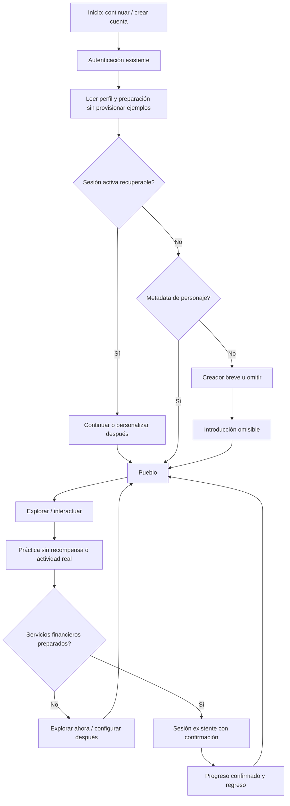

# OakHaven 5.0 — onboarding y transición

Nombre normalizado: `ONBOARDING_FLOW.md`; las barras de escape de la solicitud no forman parte del nombre. Diseño nuevo, no modificación del onboarding existente.

## Problema actual

`app/login/page.tsx:86` lleva signup a `/onboarding` y login a `/dashboard`. Onboarding presenta cinco pasos (`app/onboarding/page.tsx:131`) y publica configuración financiera/habilidades en `/api/onboarding`. Dashboard redirige allí si `onboarding_completed` es falso (`rpg-dashboard.tsx:1361–1362`). Ese flag no significa «personaje creado» y su endpoint puede resetear valores/reemplazar colecciones. No reutilizarlo para 5.0.

La propuesta mantiene autenticación y sus cookies; añade resolución de destino en shell/ruta nueva después de confirmar identidad. No cambiar registro en esta ejecución. G-SEC-01 bloquea futuras pruebas de signup real hasta resolverlo.

## Recorrido objetivo

## Secuencia de pantallas

| Paso | Contenido y acción | Omitir / duración objetivo | Datos y errores |
|---|---|---|---|
| 0 Inicio | «Continuar», «Crear cuenta», opciones accesibles | No auto-login ni datos demo de cuenta real | Usar auth actual tras corregir bloqueo de seguridad |
| 1 Personaje | Vista previa, tres grupos cosméticos; nombre/clase conservados | «Ahora no», objetivo 30–60 s | Guardar solo metadata; fallo no bloquea explorar con default |
| 2 Bienvenida | Dos frases: actividades reales desarrollan el pueblo; descansar está permitido | «Omitir introducción», objetivo ≤20 s | Estado tutorial independiente de economía |
| 3 Orientación | Un prompt por vez: moverse, acercarse, interactuar | Omitir/ayuda siempre, objetivo ≤60 s | Completar ayuda no emite actividad ni premio |
| 4 Primera elección | Actividad real, práctica de controles o explorar libre | Sin mínimo forzado de productividad | Habilidad pausada no se reactiva automáticamente |
| 5 Primera sesión | Usar un recurso propio, iniciar/pausar; contexto reducido | Se puede salir/volver sin perder sesión | Fallo de red deja pendiente con misma clave; no confeti de éxito |
| 6 Confirmación | Resumen efectivo de lo registrado y cambio del objeto | Cerrar sin reclamar otra vez | Mostrar GP/XP devueltos por autoridad, no monto estimado |
| 7 Regreso | Puerta a plaza, guardar punto seguro | Descanso sin penalización nueva | Finalizar tutorial es solo metadata |

Los tiempos son metas de diseño para la interfaz, no duración de actividad ni mediciones de usuarios. Consentimiento legal no se omite cuando es necesario; el tutorial lúdico sí. Texto claro y legible, no obligar voz/audio, ni depender de arrastrar con precisión.

## Cuenta nueva: finanzas progresivas sin inventar economía

Crear avatar/explorar no exige informar ingreso, deuda o gastos. Hasta configurar servicios, estado `financialSetupRequired`: no mostrar saldos de ejemplo como reales ni iniciar registro recompensado. Ofrecer práctica local explícita sin envío ni recompensa, que no se convierte después en una sesión pasada.

El endpoint financiero existente exige ingreso positivo/costo fijo y realiza inicialización. Antes de usarlo en 5.0 hay que introducir una operación **create-if-absent validada**, usando cálculo actual y sin reemplazar datos existentes. Si aparece tesorería por provisión anterior, no asumir que está vacía: comparar y derivar a revisión sin reset. G04 define ese trabajo; no se fuerza un «reseteo para empezar».

El camino completo de registro a primera recompensa se acepta solo cuando esa preparación segura y el adapter de sesión pasan pruebas. Hasta entonces el piloto debe ser fixture aislado o cuenta existente preparada, con rótulo de alcance. No afirmar que el flujo nuevo de signup está operativo porque se dibujó el mapa.

## Cuenta existente: transición sin replay de onboarding

1. Autenticar y recuperar perfil/estado existente. Si hay sesión activa, ofrecer continuar antes de cualquier guía.
2. Si falta metadata de personaje, mostrar una invitación única no bloqueante: «Tu historia sigue aquí. ¿Quieres elegir tu aspecto?».
3. Guardar o diferir solo metadata. Ninguna escritura a tesorería, deudas, quests, whitelist de proyectos o habilidades por entrar al creador.
4. Conservar `onboarding_completed`; tutorial tiene su propio estado/versionado. Habilidad pausada permanece pausada y progreso archivado no se convierte en cero.
5. Volver a escena/punto seguro, sin exigir rehacer finanzas. Enlace de recuperación a `/dashboard`/`/cozy` y captura `/quick`.

## Recuperación y acceso equivalente

Estado tutorial por pasos pequeños, idempotente y reanudable. No guardar cada tecla ni posición por frame. Si se interrumpe, volver a último paso seguro, no obligar repetir consentimiento o cuenta. Una persona que omite recibe las mismas herramientas y oportunidades; no hay premio exclusivo por obedecer tutorial.

Teclado: foco visible, preview con controles semánticos, Enter/E para interacción y Escape devuelve foco sin perder dato. Móvil: controles amplios, sin fullscreen/orientación obligatoria; ayuda por toque y lista de destinos. Modo lista ofrece mismo comando de bastidor y acceso al recurso; no una economía alternativa.

## Criterios de aceptación globales

- Usuario antiguo con XP/saldos y sesión activa personaliza/omite sin cambiar ningún campo económico ni historial.
- Usuario nuevo puede llegar a exploración sin valores ficticios y completar setup seguro antes de una recompensa real.
- Doble guardado de avatar no crea otra identidad; doble finalización no crea otra recompensa.
- La guía nunca envía una sesión con tiempo simulado a producción.
- Cerrar ventana, red intermitente, sesión expirada y cambio de cuenta conservan pertenencia y punto de recuperación.
- Tutorial y descanso no generan multas, racha perdida ni diálogo culpabilizante.

Pruebas G04–G11 del [backlog](IMPLEMENTATION_BACKLOG.md); no ejecutadas todavía para estas rutas propuestas.
