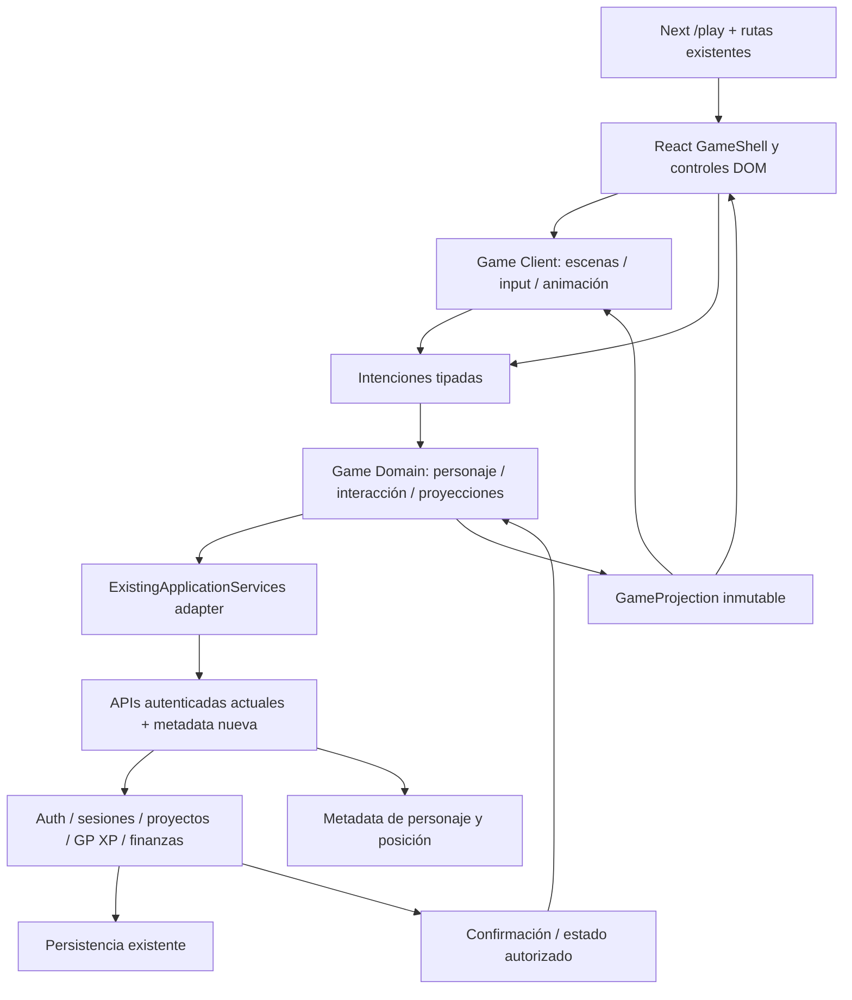

# OakHaven 5.0 — Technical Design Document

Estado: arquitectura objetivo con G00/G01 implementados localmente; distinguir el prototipo existente de los sistemas pendientes. Auditoría base en [GDD](GAME_DESIGN_DOCUMENT.md). Se conserva Next/React/TypeScript, Supabase, motores y contratos existentes salvo arreglos específicos con regresiones.

Actualización posterior G01: `/play`, shell y runtime de prototipo ya existen con Phaser **4.2.1**; la lista de archivos de este diseño sigue siendo arquitectura objetivo. No existen todavía las nuevas tablas/servicios de personaje ni el puente económico. [Resultado verificado del spike](G01_SPIKE_RESULTS.md).

## ADR-001: Phaser para el mundo; React para aplicación y accesibilidad

**Selección:** Phaser, cargado solo en cliente dentro de `/play`, con React como shell y HUD. La necesidad nueva incluye personaje, escenas, colisiones y animaciones coordinadas; el renderer DOM existente resuelve principalmente cámara y selección. PixiJS es válido para sprites, pero exigiría construir más infraestructura de gameplay. Phaser evita crear ese pequeño motor desde cero.

La decisión inicial se validó parcialmente en G01: Phaser 4.2.1 está instalado y el build/browser local pasan. Siguen pendientes perfil prolongado y hardware móvil; no confundirlos con una vista estrecha. El ejemplo React citado usa Phaser 3 y sirve como referencia del puente, no como versión instalada ni plantilla que se pueda copiar a Next sin adaptación. No se migra a Vite ni se añaden wrappers React de terceros por defecto.

| Criterio | DOM/SVG actual | PixiJS | Phaser elegido |
|---|---|---|---|
| Escenas | Componentes y modales propios | Scene graph; lifecycle de juego a diseñar | Lifecycle de escenas integrado |
| Movimiento | Cámara existente, personaje nuevo a programar | Ticker/sprites; controlador propio | Update, input y sprites; controlador acotado |
| Colisiones | Geometría propia; validación actual es colocación de edificios | Geometría/librería propia | Arcade Physics para cuerpos simples; no hace falta Matter para este corte |
| Animaciones | CSS y DOM | Ticker y animaciones de sprites | Animaciones y tweens de escena |
| Objetos | Botones accesibles, sin proximidad espacial | Eventos y hit areas; lógica propia | Input/overlaps más lógica de interacción del dominio |
| Móvil | Adaptación conocida; medir DOM/frame | GPU; medir assets, memoria y batería | Escalado/input disponibles; medir lifecycle, memoria y batería |
| React | Directo | Puente o integración adicional | Puente explícito; HUD DOM y ciclo independiente |
| Mantenimiento | Menor arranque, mayor motor artesanal si crece | Renderer flexible, más sistemas propios | Más conceptos iniciales, menos infraestructura propia de juego |
| Costo/riesgo | Bajo inmediato; crecer a simulación requiere más código | Medio; aprendizaje y runtime de juego propio | Medio en spike/piloto; migración gradual y arte son costo principal |

No se atribuye mejor FPS sin medición. Un canvas agrega trabajo de accesibilidad, gestión GPU y sincronización. Las herramientas administrativas seguirán en DOM.

Fuentes primarias consultadas: [escenas Phaser](https://docs.phaser.io/phaser/concepts/scenes), [física Phaser](https://docs.phaser.io/phaser/concepts/physics), [escalado](https://docs.phaser.io/phaser/concepts/scale-manager), [puente React/TS oficial](https://github.com/phaserjs/template-react-ts). Sirven para contrastar APIs, no para certificar nuestra integración Next. PixiJS documenta ticker, scene graph y render GPU en [render loop](https://pixijs.com/8.x/guides/concepts/render-loop); esas piezas no son una simulación completa.

## Límites de arquitectura

### Resolución de componentes — Prompt 0.1

Estos son límites de responsabilidad, no once clases obligatorias. Extender equivalentes adecuados antes de crear managers. La matriz de mecánicas y aceptación vive únicamente en [el estudio](NOOKERY_ADAPTATION_STUDY.md#8-trazabilidad-del-prompt-01).

| Sistema objetivo | Equivalente encontrado | Decisión incremental |
|---|---|---|
| GameWorld | `boot.ts` / `VillageScene`, `spike-model.ts` / `LAYOUTS` | Componer registro y proyección del mundo; conservar runtime y lifecycle G01 |
| SceneManager | `build`, `nearDoor`, destinos de `LAYOUTS` | Extraer transición con puerta/spawn y recuperación; no otra ruta Next por habitación |
| CharacterController | Actor Arcade, `movementVector`, `findRoute` | Extraer control y estado de animación; conservar geometría y algoritmos probados |
| CameraController | Follow/zoom/resize de G01; `use-village-camera.ts` para DOM anterior | Adaptar cámara Phaser por contexto; no montar dos controladores sobre el mismo mundo |
| InputManager | Teclado/puntero en G01 y pad React | Unificar intents/contextos, IME y pausa; usar InputRouter de ADR-002 como esa responsabilidad, sin duplicarlo |
| InteractionSystem | `nearDoor`, estaciones/interiores y herramientas actuales | Registro de objetos/proximidad que abre servicios existentes; no calcula recompensas |
| NPCManager | `cozy-residents-engine.ts`, roles de `village-tiers.ts` | Adaptar identidad/rol; añadir presencia y horario ambiental, sin replicar automatizaciones |
| DialogueSystem | `resident-modal.tsx`, `resident-assistant-widget.tsx` | Reutilizar contenido/servicios donde encajen; añadir conversación contextual y foco accesible; sin LLM por frame |
| InventoryPresentation | Colecciones, recursos, wishlist; sin inventario jugable unificado | Proyección de referencias y vista React, no nuevo almacén económico |
| QuestPresentation | Misiones existentes y `village-quests-modal.tsx` | Adaptar lectura/acciones actuales al tablón; ningún segundo cobro |
| WorldProgression | `visual-village-progression.ts`, `village-tiers.ts` | Reutilizar reglas visuales/hitos mediante proyección; no duplicar motor de niveles |

Las rutas de backend, tipos RPG y sesión universal continúan como autoridades. Que una vista sea reutilizable no prueba que su flujo de guardado sea seguro: G03/G04 siguen bloqueando integración con datos reales. G02.1 implementa los contratos de ADR-002 y el filtrado puro de input; los managers y su integración con el runtime siguen pendientes.



**Game Client:** solo representación e input. Sin imports de `demo-store`, `supabaseAdmin`, Gemini ni cálculo financiero. Un frame mueve sprites, no crea actividad.

**Game Domain:** tipos puros de personaje, escenas, objetos, intenciones y proyecciones de habilidades/misiones. No es un segundo motor RPG: nivel, XP, GP, misiones cumplidas y saldos se leen de servicios existentes. Inventario visual son referencias/hitos o elecciones cosméticas; no fichas intercambiables ni crafting monetario nuevo.

**Existing Application Services:** conservan auth, identidad, comandos de sesión, proyectos y economía. El adaptador envuelve sus contratos y normaliza confirmaciones. No se introduce microservicio, nuevo login, store financiero paralelo ni segunda llamada de premio.

Estructura propuesta, no creada en esta fase:

```text
src/app/play/page.tsx
src/components/game/{game-shell,game-canvas,context-hud,accessible-world}.tsx
src/game/client/{boot,scenes,input,interactions,assets}/
src/game/domain/{character,world,projection,events}.ts
src/game/application/{game-services,session-coordinator,command-result}.ts
src/game/adapters/{existing-rpg-services,character-repository}.ts
src/app/api/game/{character,world-state}/route.ts
```

Los nuevos nombres no sustituyen masivamente módulos actuales. Extraer parsers puros o hooks compartidos solo donde el piloto lo necesite. Prohibir en lint/import tests la dependencia del client al servidor privilegiado.

## Ownership y datos

G03.1c completada para el cronómetro independiente del dashboard antiguo: [modelo puro](../../src/lib/sanctuary/live-timer.ts) y [hook por propietario](../../src/lib/sanctuary/use-owned-live-timer.ts). Usa `state.user.id` directamente porque vive fuera del provider de sus hijos. No adopta `rpg_live_timer_state`; usa clave v2 codificada por ID y valida dueño dentro del checkpoint. En cambio de cuenta oculta el estado previo antes de effects y no escribe hasta hidratar al nuevo dueño. React/Strict Mode se prueba con la misma instancia de LiveProbe al alternar A/B, sin depender del remount del provider. Envíos directos del dashboard también incluyen condición de propietario para rechazar cookies de otra cuenta.

Esto aísla persistencia del cronómetro, no acredita un registro durable: finalización antigua aún resetea antes de respuesta, conserva su mínimo de un minuto y requiere G03.2. No migrar tiempo sin dueño ni tratarlo como actividad confirmada. `safeLocalStorage` conserva fallback volátil; los locks entre pestañas, coordinador único y otros datos locales tienen sus pendientes propios.

G03.1b implementada localmente: [SessionIdentityProvider](../../src/lib/sanctuary/session-identity.tsx) recibe el ID de estado autenticado en ambos dashboards y remonta sus consumidores al cambiar de cuenta. El hook puede recibir ID explícito de un host aislado, pero no contradecir un proveedor autenticado. Sin ID válido no crea sesión; el engine tampoco asigna usuario por defecto. [session-storage.ts](../../src/lib/sanctuary/session-storage.ts) separa sesión/history en claves v5 por dueño, valida pertenencia y mantiene los globales legacy intactos y sin adopción automática. Las respuestas de una instancia/identidad anterior se descartan; finalización envía condición de propietario y rechazos HTTP no limpian el pendiente.

Validación mediante siete pruebas nuevas de almacenamiento y seis escenarios React reales en Chrome/Strict Mode, con identidades y respuestas sintéticas: `npm run test:session-browser` sirve un harness en loopback 3021, separado de rutas productivas. Las pruebas no acreditan autenticación contra Supabase, idempotencia durable o coordinación única de timers. Permanece aparte el cronómetro legacy `rpg_live_timer_state` del dashboard antiguo (G03.1c), además de otros namespaces locales/resource-hub de la auditoría. No declarar aislamiento global de la aplicación ni G03 completa.

G03.1a integra propietario explícito en la cola offline y sus dos dashboards. No se lee, procesa o copia la cola global legacy; tampoco se migra automáticamente a quien inicia sesión. El header `X-RPG-Offline-Owner` es una condición adicional contrastada por `requireShortcutUser` con la identidad autenticada, no una credencial. Si cambian las cookies durante una sincronización, un pendiente de otra cuenta recibe 409 y se conserva. Solo se reenvía a shortcuts propios conocidos. Exclusión en vuelo es por dueño y pestaña; no es un lock entre pestañas ni sustituye idempotencia servidor. Confirmación de dominio más estricta queda en G03.2. El hook universal y su historial global aún necesitan G03.1b antes de declarar aislamiento completo; el almacenamiento volátil y la recuperación manual de legacy siguen siendo límites explícitos.

Implementación G02.2 acotada: [projection.ts](../../src/game/domain/projection.ts) ofrece `projectRpgReadModel` para snapshots ya obtenidos. El host suministra propietario esperado y procedencia; el módulo no verifica sesión ni consulta `/api/state`. Lee `player_level`, `current_xp`, `wallet_gp`, `vault_remaining_gp` y los campos disponibles de `skill_summaries`; no usa el alias antiguo `vault_gp`, ni calcula XP acumulado a partir de XP actual. Valores desconocidos quedan `null` y se registran incidencias; los saldos negativos se conservan. `ready` significa que los campos de esta proyección están presentes, no que onboarding/auth/finanzas sean seguros para producción.

QuestPresentation usa ID existente o código legado, y solo reconoce estados explícitos; ausencia/estado desconocido se muestra unavailable, sin deducir avance desde logs ni generar recompensas. InventoryView referencia libros, proyectos de trabajo y tejido; viewId incluye colección para evitar colisiones. No se implementan aún cosméticos/decoraciones ni acciones de canje. El resultado es profundamente inmutable, separado de las referencias de origen, y la procedencia fixture permanece visible. [Pruebas](../../tests/game-projection.test.ts) cubren valores exactos, datos antiguos/malformados, aislamiento básico por sobre de propietario y ausencia de datos sensibles. Autorización real y confirmación durable siguen pendientes de G03/G04; no conectar snapshots arbitrarios a cuentas reales.

| Estado | Autoridad | Copias permitidas |
|---|---|---|
| Identidad | Sesión verificada actual | User ID en contexto; no email/token enviado al renderer |
| GP/XP/nivel/deudas/misiones | Servicios y persistencia existentes | Proyección de lectura, nunca otro saldo mutable |
| Sesión activa | Coordinador único montado en shell autenticado | HUD/escena observan mismo objeto, no otro timer por edificio |
| Apariencia/tutorial | Metadata propia, PK = ID autenticado | Cache validada por usuario y revisión |
| Posición | Runtime efímero + checkpoint seguro | Persistir al cambiar escena/ocultarse, no cada frame |
| Obra/decoración ganada | Hitos existentes confirmados | Proyección reproducible; no nuevo premio |
| Conversación/hover | Cliente | No necesita tabla ni LLM por defecto |

`GET /api/state` puede aprovisionar datos si falta tesorería (`state-builder.ts:118–127`, `auth.ts:967–1020`). **No tratarlo como lectura sin efectos para una cuenta nueva sin configurar.** El bootstrap de 5.0 debe resolver readiness por perfil verificado antes de llamar esa ruta, y bloquear provisión ficticia. Esto exige un adaptador/lectura acotada de estado de preparación, no rehacer auth ni usar un store de demo como dinero real.

## Contratos de interacción y sesión

Implementación local G03.2a: [session-command.ts](../../src/lib/sanctuary/session-command.ts) captura un comando JSON antes del primer envío, conserva contenido/clave durante reintentos y registra confirmación por ID. Hook/cronómetro pausan el tiempo al finalizar y solo limpian tras respuesta válida. El recibo local y la exclusión en vuelo son defensas de UI; **no son idempotencia SQL durable**. Ack de shortcuts se centraliza en [shortcut-acknowledgement.ts](../../src/lib/shortcut-acknowledgement.ts). `persistProfileCollections` verifica la fila realmente actualizada; la ruta no confirma una persistencia fallida. La atomicidad entre actividad/recurso/snapshot requiere G03.2b. Evidencia y bloqueos de despliegue en [resultados](G03_SESSION_RELIABILITY_RESULTS.md).

Intenciones permitidas: `EnterBuilding`, `InteractObject`, `StartExistingSession`, `PauseSession`, `ResumeSession`, `SubmitSession`, `SaveAppearance`, `SaveCheckpoint`. No aceptar `GrantXP`, `MintGP` o mutación arbitraria de tabla.

Cada petición con efecto reutiliza su ID estable durante reintentos. El servidor obtiene propietario de la sesión y verifica recursos; `userId` enviado por cliente no autoriza nada. La navegación puede confirmar interacción espacial en cliente porque no tiene valor económico; el pago de recompensa nunca depende de estar cerca de un mueble.

Flujo de finalización: preparar payload canónico → persistir pendiente acotado al usuario → un envío al endpoint existente → validar HTTP y resultado de dominio → actualizar desde estado confirmado → emitir efecto visual una vez. Confirmación propuesta normalizada: `operationId`, `sessionId`, resultado efectivo GP/XP y estado/revisión disponible. Si la respuesta actual no contiene una confirmación durable suficiente, no simularla en frontend: tarea de compatibilidad G03.

Idempotencia en dos niveles: el backend impide repetir el efecto económico; la UI puede recordar `operationId` para no repetir la celebración. El registro visual no reemplaza una transacción durable. Al reconectar se reconcilia por ID, no se calcula otra recompensa. No reenviar tanto `habit-log` como `skill-session` por la misma sesión.

Estados de presentación separados de los estados actuales del motor: `active`, `paused`, `saving`, `pendingSync`, `confirmed`, `failed`. No llamar `resetSession` hasta confirmación; un 401 congela envío y pide login del mismo usuario, no lo reasigna. Un 503 conserva payload y clave. Conflicto de revisión requiere reconciliación. Un doble clic en finalizar comparte promesa/operación en vuelo.

## Escenas y lifecycle

Primer corte: Boot → Town → Atelier. React controla entrada de cuenta/creador y diálogos accesibles. Scene transition conserva coordinador de sesión, destino de vuelta y propietario. Al cambiar usuario destruir game instance, limpiar proyección/contexto y rehidratar solo el suyo.

Runtime creado después de montar componente cliente, con import dinámico sin SSR. Strict Mode debe poder montar/desmontar dos veces sin duplicar listeners, workers, canvas o timer. `destroy` cancela render/listeners; pausa de canvas en pestaña oculta no pausa automáticamente una sesión real; el reloj usa timestamps y pausas explícitas. Reanudar no transforma horas de sueño en actividad inventada: mostrar duración transcurrida y pedir revisión/continuación según contrato.

Controles: WASD/flechas, interacción E/Enter, Escape abre pausa sin interrumpir sesión salvo decisión expresa. En móvil toque para destino con ruta caminable sencilla; botón contextual. Diagonales normalizadas; velocidad por delta acotado al reanudar para evitar saltos. Colisión de pies con paredes/agua y zonas bloqueadas; proximidad tiene radio fijo. Salida y spawn siempre validados; ubicación inválida vuelve a punto seguro.

## Persistencia, recuperación y seguridad

Nueva metadata aditiva según [MIGRATION_PLAN.md](MIGRATION_PLAN.md). No guardar snapshots económicos dentro de ella ni enviar secretos al bridge. `/dashboard`, `/cozy`, `/quick` siguen disponibles como recuperación; una bandera controla `/play`. Error de carga de assets ofrece reintentar o ruta existente sin tocar registros.

G-SEC-01 es puerta antes de probar registro real. S-001 y G-SESSION-01 son puertas antes del piloto con recompensa. RLS probada con dos identidades y cliente ordinario; sin grants a tablas económicas nuevos. Sin llamadas externas de IA en el loop. Despliegue requiere autorización futura; la bandera no se activa globalmente desde este plan.

## Presupuestos de rendimiento y calidad propuestos

Objetivos de piloto, todavía no mediciones: 30 FPS sostenidos como mínimo en móvil de referencia acordado, preferir 60 en equipo capaz; frame p95 ≤33 ms en prueba de cinco minutos; un solo canvas/loop y carga diferida de interiores/atlas. Registrar dispositivo, navegador, DPR, memoria/tareas largas y red para que la comparación sea reproducible. No actualizar React a 60 Hz con coordenadas; HUD se actualiza por cambio relevante y timer como máximo 1 Hz.

Limitar DPR móvil inicialmente a un valor validado en spike; degradar partículas/sombras sin cambiar reglas. Audio solo tras gesto, opción reduced motion y pausa del renderer fuera de vista. Accesibilidad por DOM semántico, no depender de que canvas sea interpretable por lector de pantalla.

Tests del plan: contratos de proyección, input/colisión con reloj simulado, lifecycle/Strict Mode, conservación de progreso, replay de sesión, red intermitente, dos usuarios, migración aditiva y recorrido de navegador. Matriz y tareas en [IMPLEMENTATION_BACKLOG.md](IMPLEMENTATION_BACKLOG.md). No instalar framework de pruebas adicional antes de revisar herramientas disponibles y su utilidad.

## Decisiones para aprender

- Render loop y transacción tienen relojes distintos: un frame puede descartarse, un movimiento financiero debe quedar confirmado.
- Una proyección transforma datos existentes en representación, sin convertirse en otra autoridad.
- Un adaptador conserva backend y reduce acoplamiento; evita reescribir por cambiar el tipo de interfaz.
- Una escena puede morir y volver a existir; la sesión del usuario no debe depender de su montaje.

## ADR-002: patrones de interacción y contratos originales

Complemento documental autorizado a partir del [estudio de Nookery](NOOKERY_ADAPTATION_STUDY.md), fijado a fuentes verificadas. No es integración del port. G02.1 ya implementa los contratos originales y el filtrado puro de input, sin conectarlos a servicios ni al runtime. Se mantiene ADR-001 y G01; Aurora no es dependencia web. Los contratos siguientes son **propuesta original**, no traducciones de structs, enums o algoritmos externos. Fuente de verdad implementada: [contracts.ts](../../src/game/domain/contracts.ts).

### Contratos de dominio y presentación

Los diez contratos y tipos auxiliares se mantienen solo en [contracts.ts](../../src/game/domain/contracts.ts), evitando una copia divergente en Markdown. [input-context.ts](../../src/game/domain/input-context.ts) filtra inputs de mundo con contexto exclusivo; no instala listeners ni gestiona teclas retenidas. El futuro host debe limpiar teclas/rutas al cambiar contexto y no reenviar eventos antiguos. [Regresiones](../../tests/game-domain.test.ts) verifican bloqueo, vectores, referencias y límites de imports, además de restricciones de tipos comprobadas por TypeScript.

Scene describe espacio; SceneTransition es el estado de cruce, no una nueva sesión. Character no contiene identidad alternativa ni saldo. PlayerInput expresa intención independiente del dispositivo. InteractiveObject apunta a herramientas; NPC describe presencia y Dialogue presenta conversación. InventoryView y QuestPresentation son proyecciones de lectura. WorldEvent distingue observación visual de confirmación de actividad; `eventId` nunca sustituye la clave idempotente del comando existente.

Los tipos son contrato de diseño, no una autorización: los IDs/objetos se validarán en ejecución, el servidor derivará el usuario y la pertenencia del recurso. Un cliente no puede publicar una confirmación autorizada por construir un objeto con ese `kind`. El adaptador que acepta confirmación debe quedar fuera de la API pública de escena y comprobar resultado HTTP/de dominio e identidad antes de producir el evento.

### Sistemas de ejecución propuestos

- **CharacterController:** consume input semántico y delta acotado, produce nueva pose/estado. No calcula duración productiva, XP ni GP; no sustituye el motor RPG.
- **CollisionSystem:** consulta geometría de escena y resuelve desplazamiento sólido. Reutiliza Arcade de G01 y las reglas puras de navegación, sin reproducir física nativa del port.
- **InteractionRange:** resuelve objeto cercano visible, con rango propio y prioridad estable; ofrece acción DOM equivalente. Cercanía no prueba permiso para modificar recurso.
- **InputRouter:** exploration/overlay/text exclusivos; entrada en campo de texto e IME suspenden controles de mundo, `blur` cancela dirección y entrada de fondo queda apagada. Remapeo conserva una forma de salir/restaurar defaults.
- **SceneManager:** un solo comando de transición en vuelo, destino preparado antes de confirmar, aparición validada, restauración anterior si falla y coordinador de sesión fuera de escenas. No usar rutas Next como única exploración.
- **ContextualCamera:** estados exploration/conversation/entry/object/story/pause; un contexto propietario cada vez, prioridades explícitas y restauración. Cámara reducida puede cambiar encuadre inmediatamente; no impone una espera para usar herramienta.

### Objeto → servicio → representación, una sola vez

1. Interacción con mesa emite `open-tool/session` con recurso propio; abrir panel no registra actividad.
2. Solo confirmar actividad real invoca el servicio existente, con clave idempotente estable y permisos actuales.
3. Fallo/401/503 conserva pendiente del mismo propietario; ningún sprite interpreta animación como pago.
4. Resultado confirmado produce `activity.confirmed`; la proyección vuelve a leer valores efectivos de la autoridad existente.
5. El mundo celebra/proyecta una vez por operación; recargar o repetir evento puede actualizar vista, pero nunca ejecutar otra recompensa.

### Preferencias, guardado y viaje rápido

Guardar metadata/checkpoint con revisión y error visible, usando persistencia existente/adaptadores previstos en G05. No confundir checkpoint exitoso con sesión confirmada. Sin nuevos formatos de partida económica. Preferencias de texto, teclas, audio por canal y animación requieren namespace por usuario y migración de formato; no se aplican copiando globalmente el almacenamiento del port.

Viaje rápido usa el mismo SceneTransition: no crea actividad, no cuesta moneda y no finaliza sesión. Durante envío de sesión se puede viajar conservando coordinador; cerrar juego requiere guardar pendiente o informar fallo, no descartar silenciosamente. Una narrativa omitida vuelve al punto seguro sin pérdida de progreso.

Las reglas de bienestar se aplican a nuevos eventos: cama/descanso/ausencia no introducen multas, deuda, espera obligatoria ni degradación. Rachas y economía heredadas se conservan; cualquier conflicto real con bienestar se documenta para decisión separada, nunca se altera desde un NPC o cámara.
